# Parte 1. Antes de leer el código

## Cómo usar este documento

Este documento explica **por qué existe y cómo funciona cada fragmento de código** del
proyecto. Está organizado en tres partes:

- **Parte 1 (esta):** respuestas directas a las preguntas de la revisión — cómo se separaron
  los datos, qué es la curva de log loss, por qué se usan intervalos de confianza y por qué
  los modelos están en cuadernillos — y un repaso de las piezas de Python que se repiten en
  todo el código.
- **Parte 2:** los nueve cuadernillos, celda de código por celda de código. Cada celda aparece
  copiada tal cual, seguida de *qué hace* (línea por línea cuando hace falta) y *por qué* está
  ahí. Cada gráfico aparece con su imagen y con tres explicaciones: por qué se eligió, cómo se
  lee y qué muestra.
- **Parte 3:** las funciones de la carpeta `src/`, que los cuadernillos importan, explicadas
  bloque por bloque.

La numeración de las celdas en la Parte 2 (por ejemplo, **05.3**) significa "cuadernillo 05,
tercera celda de código".

## Qué cambió después de la revisión

| Observación | Qué se hizo | Dónde verlo |
|---|---|---|
| 1. Los modelos deben ir en cuadernillos, no en `.joblib` | Se eliminaron los archivos `.joblib`. Ahora la carpeta `models/` contiene un cuadernillo por modelo, que lo entrena, lo evalúa y lo interpreta: 05 (regresión logística), 06 (Random Forest) y 07 (Gradient Boosting). El 08 los compara y evalúa el modelo final. | Cuadernillos 05 a 08 |
| 2. Explicar cómo se interpretan los gráficos y por qué se eligieron | Debajo de cada gráfico hay un bloque con **Por qué este gráfico**, **Cómo se lee** y **Qué muestra**. | Todos los cuadernillos; Parte 2 de este documento |
| 3. Simplificar los cuadernillos | De 25 gráficos se pasó a 16. Se quitaron los análisis que repetían una idea ya mostrada (por ejemplo, dos mapas de calor de mapas jugados, el bootstrap, la importancia por permutación previa a la selección y varios gráficos de calibración). El código de cada cuadernillo se escribió de la forma más directa posible. | Todos los cuadernillos |
| 4. Documento que explique cada fragmento de código | Este documento. | — |
| 5. Cómo se separaron los datos | Sección propia en el cuadernillo 04 y en este documento. | Cuadernillo 04; sección "Cómo se separaron los datos" |
| 6. Qué es la curva de log loss | Se explica el log loss con un ejemplo calculado a mano y se dibujan dos curvas de log loss. | Cuadernillos 05 y 07; sección "La curva de log loss" |
| 7. Por qué se usan intervalos de confianza | Se calculan con una fórmula sencilla para cada modelo, en validación y en prueba. | Cuadernillos 05 a 08; sección "Por qué se usan intervalos de confianza" |

## El recorrido completo

Los cuadernillos se ejecutan en orden; cada uno guarda lo que el siguiente necesita.

| Cuadernillo | Qué hace | Qué deja guardado |
|---|---|---|
| 00 Comprensión de los datos | Inventario del dataset y elección de tablas | Inventario de tablas |
| 01 Limpieza y tabla base | Une los seis años, limpia y ordena en el tiempo | `data/interim/maps.csv` (27 368 mapas) |
| 02 Análisis exploratorio | Entiende el objetivo y busca señales | — |
| 03 Ingeniería de variables | Construye 16 variables históricas sin fuga de datos | `data/processed/dataset.csv` |
| 04 Partición y selección | Separa por año y elige 11 variables | Lista de variables en `config.yaml` |
| 05 Regresión logística | Primer modelo; descubre el problema de calibración y lo corrige | Umbral de historial en `config.yaml`; resultados |
| 06 Random Forest | Segundo modelo | Resultados |
| 07 Gradient Boosting | Tercer modelo; curva de log loss y sobreajuste | Resultados |
| 08 Comparación y evaluación final | Compara, ajusta y evalúa una sola vez en 2026 | Resultados finales |

## Cómo se separaron los datos

### La regla: por año, nunca al azar

En los ejemplos de clase los datos se separan con `train_test_split`, que reparte las filas
**al azar** (por ejemplo, 70 % para entrenar y 30 % para probar). Aquí no se puede hacer así,
porque el modelo predice partidos **futuros**. Si se mezclaran los años, el modelo aprendería
con mapas de 2026 y se evaluaría con mapas de 2024: estaría usando el futuro para predecir el
pasado, algo imposible en la vida real, y el resultado saldría mejor de lo que es.

Por eso la separación se hace **por año**, con la función `temporal_split` (Parte 3):

```
2021   2022   2023   2024  |  2025        |  2026
└──── entrenamiento ─────┘ |  validación  |  prueba
```

| Conjunto | Años | Mapas | Para qué se usa |
|---|---|---|---|
| Entrenamiento | 2021–2024 | 25 210 | Con estos mapas aprenden los modelos y se eligen las variables. |
| Validación | 2025 | 1 272 | Mapas que los modelos no vieron. Sirven para comparar modelos y tomar decisiones. |
| Prueba | 2026 | 886 | Se guardan "bajo llave" hasta el final. Miden una sola vez el modelo elegido. |

**¿Por qué tres conjuntos y no dos?** Porque al comparar varios modelos en un mismo conjunto
siempre se termina eligiendo el que mejor salió *en ese conjunto*, en parte por suerte. Si
después se reportara ese mismo número, estaría inflado. La prueba no participa en ninguna
decisión, así que su resultado es honesto.

### Tres detalles que completan la partición

1. **Filtro del entrenamiento (cuadernillo 05).** De los 25 210 mapas de entrenamiento, los
   modelos solo aprenden con los **5 106** en los que ambos equipos tenían al menos 30 mapas
   previos. El motivo: 2021–2022 está lleno de clasificatorios abiertos entre equipos amateur,
   muy distintos de las ligas actuales que se quiere predecir. La validación y la prueba **no**
   se filtran: se mide siempre sobre todos sus mapas.
2. **Entrenamiento final (cuadernillo 08).** Una vez elegido el modelo con la validación, 2025
   ya no hace falta para comparar, así que se suma al entrenamiento. El modelo final aprende
   con 6 188 mapas de 2021–2025 (ya filtrados) y se evalúa en 2026.
3. **Validación cruzada temporal (cuadernillo 08).** Para elegir la configuración del modelo
   final, los 6 188 mapas se ordenan en el tiempo y se cortan en cinco bloques consecutivos
   (`TimeSeriesSplit`). Cada configuración se entrena con los bloques anteriores y se mide en
   el siguiente. Es la misma regla — entrenar con el pasado, medir con lo que viene después —
   repetida cinco veces.

### Por qué la partición no es la única protección

Separar por año impide que el modelo *entrene* con el futuro, pero las **variables** también
podrían "ver" el futuro. Por eso, en el cuadernillo 03, cada variable de un mapa se calcula
solo con mapas de **etapas anteriores**, y el archivo `tests/test_features.py` lo comprueba de
forma automática.

## La curva de log loss

### Primero: qué es el log loss

El log loss mide qué tan buenas son las **probabilidades** que da un modelo. A cada mapa se le
pone una penalización igual a **−log(probabilidad que el modelo le dio a lo que realmente
pasó)**, y el log loss es el promedio de esas penalizaciones. **Menor es mejor.**

| Mapa | El modelo dijo "gana A" con… | Ganó | Probabilidad de lo que pasó | Penalización |
|---|---|---|---|---|
| 1 | 90 % | A | 0.90 | −log(0.90) = 0.105 |
| 2 | 60 % | A | 0.60 | −log(0.60) = 0.511 |
| 3 | 80 % | **B** | 0.20 | −log(0.20) = 1.609 |
| | | | **Log loss (promedio)** | **0.742** |

El tercer mapa pesa más que los otros dos juntos: equivocarse **estando seguro** se castiga
mucho. Un modelo que responde siempre "50 %" recibe −log(0.5) = **0.693** en todos los mapas;
ese valor es la referencia de "no saber nada". Un modelo con log loss mayor que 0.693 da
probabilidades peores que no saber nada.

Se eligió el log loss como criterio principal porque en un juego tan parejo lo útil no es
decir "gana A", sino decir "A tiene 62 % de probabilidad" y que eso sea cierto.

### Qué es una curva de log loss

Una **curva de log loss** es un gráfico de líneas que muestra cómo cambia el log loss cuando
se cambia **una sola cosa** del modelo. En el eje horizontal va lo que se cambia; en el
vertical, el log loss medido en datos que el modelo no vio. Se lee buscando el punto más bajo
de la curva y viendo si cruza la línea de 0.693. En el proyecto hay dos:

**1. Curva de log loss según el historial mínimo (cuadernillo 05).** Lo que cambia es con qué
mapas se entrena: se exige que ambos equipos tengan al menos 0, 5, 10, 20, 30, 50 u 80 mapas
previos. Con todos los mapas el log loss es 0.84 (mucho peor que 0.693); baja al exigir más
historial y cruza la referencia alrededor de 30 mapas. Esa curva es la que justifica entrenar
solo con mapas en los que ambos equipos tienen 30 o más mapas previos.

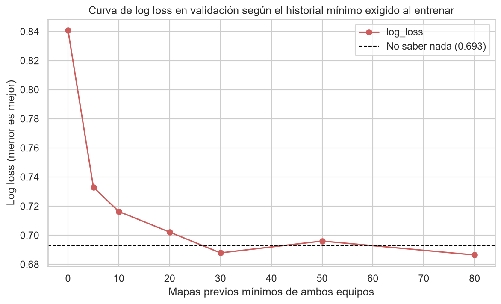

**2. Curva de log loss según el número de árboles (cuadernillo 07).** Lo que cambia es cuántos
árboles lleva el Gradient Boosting. Es una *curva de aprendizaje*, parecida a la que se vio en
clase con la exactitud, pero medida con log loss. Muestra el **sobreajuste** con claridad: en
entrenamiento (gris) el log loss baja sin parar, mientras que en validación (rojo) baja solo al
principio y después sube por encima de 0.693, porque el modelo empieza a memorizar los mapas de
entrenamiento. El modelo conservador (azul) se detiene antes de que eso pase.

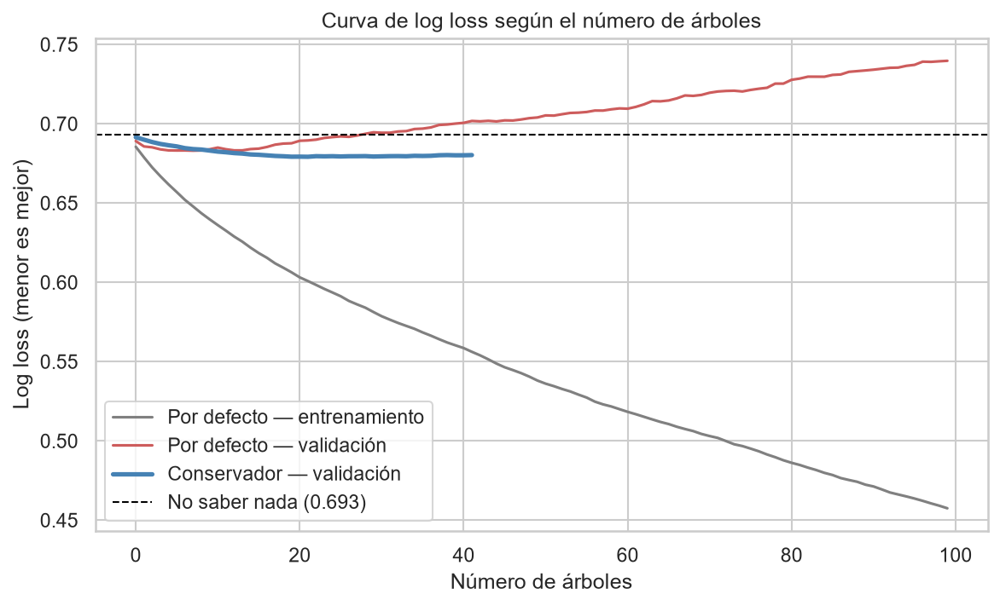

La otra curva del proyecto, la **curva ROC** (cuadernillo 08), mide otra cosa: qué tan bien
*ordena* el modelo los mapas, sin mirar si las probabilidades son correctas. Se explica junto
a su gráfico en la Parte 2 (celda 08.9).

## Por qué se usan intervalos de confianza

El modelo final acertó el **57.1 %** de los 886 mapas de 2026. Pero si se hubiera medido sobre
otros 886 mapas parecidos, por puro azar habría salido un número algo distinto: 55 %, 59 %…
Un porcentaje medido sobre una muestra tiene **margen de error**, igual que una encuesta.

El **intervalo de confianza del 95 %** da el rango donde está razonablemente la exactitud
"verdadera" del modelo. Para una proporción se calcula así:

$$\text{exactitud} \pm 1.96 \times \sqrt{\frac{\text{exactitud} \times (1 - \text{exactitud})}{n}}$$

donde *n* es el número de mapas y 1.96 es el valor de la distribución normal que deja el 95 %
de los casos en el centro. Con 0.571 y 886 mapas: 1.96 × √(0.571 × 0.429 / 886) ≈ 0.033, así
que el intervalo va de **53.9 % a 60.4 %**.

Se usan por tres razones, y cada una cambia una conclusión del proyecto:

1. **Saber si el modelo es mejor que el azar.** El intervalo del modelo final (53.9 %–60.4 %)
   queda completo por encima del 50 %: la ventaja sobre lanzar una moneda no es suerte.
2. **No sacar conclusiones de diferencias pequeñas.** En validación, los tres modelos tienen
   exactitudes de 56.4 %, 57.2 % y 57.5 %, con intervalos de unos ±2.7 puntos que **se
   solapan**. Con 1 272 mapas no se puede afirmar que uno sea mejor que otro por la exactitud;
   por eso la decisión se tomó con un criterio fijado de antemano (el log loss).
3. **Reportar el resultado con honestidad.** Decir "57.1 %" a secas sugiere una precisión que
   no existe. Decir "57.1 % (IC 95 %: 53.9 %–60.4 %)" deja claro que el modelo supera al
   azar, pero que su ventaja sobre la regla simple del winrate (56.0 %, IC 52.7 %–59.4 %) cabe
   dentro del margen de error.

Los intervalos se calculan con la función `accuracy_interval` (Parte 3) en los cuadernillos 05
a 08.

## Por qué los modelos están en cuadernillos y no en `.joblib`

Antes, los modelos entrenados se guardaban como archivos `.joblib` (un formato que "congela"
un objeto de Python en disco). Ahora cada modelo vive en su cuadernillo, y los tres cuadernillos de modelos están en la carpeta `models/`:

- El cuadernillo contiene **todo** lo que define al modelo: los datos que usa, su
  configuración, el entrenamiento y la evaluación. Un archivo `.joblib` es una caja cerrada que
  no se puede leer.
- Ejecutar el cuadernillo produce **exactamente el mismo modelo** cada vez, porque todos los
  pasos con azar usan la misma semilla (`seed: 42` en `config.yaml`).
- Entre cuadernillos solo se pasan **resultados** (tablas pequeñas con las métricas en
  `reports/tables/`), que es lo único que el cuadernillo de comparación necesita.

## Piezas de Python que se repiten

Estas construcciones aparecen en casi todos los cuadernillos. Se explican aquí una vez.

| Código | Qué significa |
|---|---|
| `import pandas as pd` | Trae la librería pandas y le pone el alias corto `pd`. |
| `from src.config import load_config` | Trae una función concreta de un módulo; aquí, de los archivos propios del proyecto. |
| `df.shape` | Atributo (sin paréntesis): `(filas, columnas)` de la tabla. |
| `df.head()` | Método (con paréntesis): primeras 5 filas. |
| `df["col"]` / `df[["a", "b"]]` | Una columna (devuelve una Serie) / varias columnas (devuelve una tabla). |
| `df[df["year"] == 2025]` | Filtro: la condición crea una columna de `True`/`False` (una *máscara*) y se conservan las filas con `True`. |
| `&`, `|`, `~` | "y", "o" y "no" entre máscaras. Cada condición va entre paréntesis. |
| `.mean()` sobre 0 y 1 | Como `True` vale 1 y `False` 0, el promedio es una **proporción**. |
| `df.groupby("year")["x"].mean()` | Agrupa las filas por año y calcula el promedio de `x` en cada grupo. |
| `.agg(nombre=("col", "funcion"))` | Calcula varias cosas por grupo a la vez, con el nombre que se quiera. |
| `a.merge(b, on="clave", how="left")` | Une dos tablas por una columna común, conservando todas las filas de `a`. |
| `pd.concat([a, b])` | Apila tablas una debajo de otra. |
| `f"{x:.1%}"` | Texto con un valor dentro; `:.1%` lo muestra como porcentaje con un decimal. |
| `[f for f in lista if condición]` | Lista por comprensión: una lista nueva con los elementos que cumplen la condición. |
| `assert condición` | Comprobación: si la condición es falsa, el cuadernillo se detiene con un error. |
| `modelo.fit(X, y)` | Entrena el modelo: `X` son las variables, `y` el resultado que debe aprender. |
| `modelo.predict_proba(X)[:, 1]` | Probabilidad de la clase 1 (gana Team A) para cada fila de `X`. |
| `make_pipeline(paso1, paso2, modelo)` | Encadena pasos de preparación y el modelo en un solo objeto que se entrena y predice de una vez. |
| `random_state=SEED` | Fija la semilla del azar para que el resultado sea siempre el mismo. |
| `save_fig("nombre")` | Guarda el gráfico actual en `reports/figures/nombre.png`. |

# Parte 2. Los cuadernillos, celda por celda

## Cuadernillo 00 — Comprensión de los datos

Archivo: `notebooks/00_comprension_de_datos.ipynb`

### 00.1

```python
import sys
sys.path.append("..")

import pandas as pd
import matplotlib.pyplot as plt

from src.config import RAW_DIR, TABLES_DIR, load_config
from src.data_loading import load_table, load_ids
from src.plotting import set_style, save_fig

set_style()
pd.set_option("display.max_columns", 50)
config = load_config()
config["years"]
```

**Qué hace:** prepara el cuadernillo. Trae las librerías y las funciones propias del proyecto.

- `sys.path.append("..")`: los cuadernillos están en `notebooks/` (los de los modelos, en `models/`) y las funciones en `src/`, una carpeta más arriba. Esta línea le dice a Python que también busque módulos en la carpeta padre (`..`); sin ella, `from src...` daría error.
- `import pandas as pd`: pandas es la librería de tablas (DataFrames). `matplotlib.pyplot` es la de gráficos.
- `from src.config import ...`: trae las rutas del proyecto (`RAW_DIR` = carpeta de datos crudos, `TABLES_DIR` = carpeta donde se guardan tablas) y `load_config`, que lee `config/config.yaml`.
- `set_style()`: fija un mismo estilo visual para todos los gráficos del proyecto.
- `pd.set_option("display.max_columns", 50)`: por defecto pandas oculta columnas cuando hay muchas; con esto muestra hasta 50.
- `config["years"]`: `config` es un diccionario; al dejar esta expresión en la última línea, Jupyter muestra su valor (la lista de años 2021–2026).

**Por qué:** tener las rutas y los años en un solo lugar (`config.yaml`) evita escribirlos a mano en cada cuadernillo y equivocarse.

### 00.2

```python
def count_rows(path):
    with open(path, "rb") as f:
        return sum(1 for line in f) - 1   # líneas del archivo menos el encabezado

rows = []
for path in sorted(RAW_DIR.glob("vct_*/*/*.csv")):
    rows.append({
        "year": int(path.parts[-3][-4:]),             # carpeta "vct_2021" -> 2021
        "table": f"{path.parts[-2]}/{path.name}",     # subcarpeta/archivo
        "rows": count_rows(path),
        "columns": len(pd.read_csv(path, nrows=0).columns),
        "size_mb": round(path.stat().st_size / 1e6, 1),
    })
inventory = pd.DataFrame(rows)
inventory.to_csv(TABLES_DIR / "00_inventario_tablas.csv", index=False)

print(f"Archivos: {len(inventory)}  |  Tablas distintas: {inventory['table'].nunique()}  |  "
      f"Tamaño total: {inventory['size_mb'].sum() / 1000:.2f} GB")
inventory.pivot(index="table", columns="year", values="rows")
```

**Qué hace:** recorre todos los archivos CSV del dataset y arma una tabla (el inventario) con el año, el nombre de la tabla, cuántas filas y columnas tiene y cuánto pesa.

- `count_rows(path)`: abre el archivo y cuenta sus líneas una por una (`sum(1 for line in f)`), sin cargarlo completo en memoria. Se resta 1 porque la primera línea es el encabezado.
- `RAW_DIR.glob("vct_*/*/*.csv")`: busca todos los archivos que cumplan ese patrón: carpeta que empieza por `vct_`, cualquier subcarpeta, cualquier `.csv`. `sorted` los ordena.
- `path.parts`: divide la ruta en sus partes. `path.parts[-3]` es la carpeta del año (`vct_2021`) y `[-4:]` toma sus últimos 4 caracteres (`2021`).
- `pd.read_csv(path, nrows=0)`: lee solo el encabezado (cero filas), suficiente para contar columnas sin gastar memoria.
- `path.stat().st_size / 1e6`: tamaño del archivo en bytes, pasado a megabytes.
- `rows.append({...})`: cada archivo aporta un diccionario; al final `pd.DataFrame(rows)` convierte la lista de diccionarios en una tabla.
- `inventory.pivot(...)`: reorganiza la tabla para verla "ancha": una fila por tabla, una columna por año y las filas contadas en cada celda.

**Por qué:** antes de analizar hay que saber qué hay. El inventario muestra que las 21 tablas existen en los seis años y que 2021–2022 concentran casi todo el volumen.

### 00.3

```python
maps_scores = load_table("matches/maps_scores.csv")
print(maps_scores.shape)
maps_scores.head()
```

**Qué hace:** carga la tabla de marcadores de los seis años en un solo DataFrame y muestra su tamaño y sus primeras filas.

- `load_table(...)` (de `src/data_loading.py`) lee el mismo archivo en cada carpeta anual, le agrega la columna `Year` y pega todo.
- `.shape` es un atributo (sin paréntesis) que devuelve `(filas, columnas)`.
- `.head()` muestra las primeras 5 filas.

**Por qué:** esta es la tabla más importante: cada fila es un mapa, que es justo lo que se quiere predecir.

### 00.4

```python
per_year = maps_scores.groupby("Year").agg(maps=("Map", "size"), tournaments=("Tournament", "nunique"))

ax = per_year["maps"].plot.bar(color="steelblue")
ax.set(title="Mapas jugados por año", xlabel="Año", ylabel="Mapas")
ax.bar_label(ax.containers[0])
plt.xticks(rotation=0)
save_fig("00_mapas_por_anio")
plt.show()
per_year
```

**Qué hace:** cuenta mapas y torneos por año y dibuja un gráfico de barras con los mapas.

- `groupby("Year")`: agrupa las filas por año.
- `.agg(maps=("Map", "size"), tournaments=("Tournament", "nunique"))`: por cada año calcula dos cosas y les pone nombre: `size` cuenta filas (mapas) y `nunique` cuenta valores distintos (torneos).
- `per_year["maps"].plot.bar(...)`: pandas dibuja las barras y devuelve el objeto `ax` (los ejes), que sirve para seguir ajustando el gráfico.
- `ax.set(...)`: título y nombres de los ejes. `ax.bar_label(...)` escribe el número encima de cada barra.
- `plt.xticks(rotation=0)`: deja los años horizontales.
- `save_fig("00_mapas_por_anio")`: guarda la imagen en `reports/figures/`. `plt.show()` la muestra.

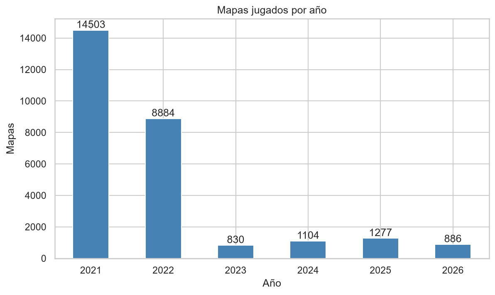

**Por qué este gráfico:** el número de mapas por año define cuántos datos hay para entrenar y para probar. Se eligieron barras porque se comparan cantidades entre pocas categorías (seis años).

**Cómo se lee:** cada barra es un año; su altura (y el número encima) es la cantidad de mapas jugados ese año.

**Qué muestra:** 2021 y 2022 concentran la gran mayoría de los mapas. En esos años el circuito incluía decenas de clasificatorios regionales abiertos; desde 2023 VCT pasó a un formato de ligas con equipos fijos y muchos menos torneos.

### 00.5

```python
overview_2024 = load_table("matches/overview.csv", years=[2024])
print(overview_2024.shape)
print(overview_2024["Side"].value_counts().to_dict())
print(sorted(overview_2024["Map"].unique()))
overview_2024.head(4)
```

**Qué hace:** carga las estadísticas por jugador de 2024 y revisa dos columnas clave.

- `years=[2024]`: `load_table` acepta una lista de años; aquí solo se pide uno.
- `["Side"].value_counts().to_dict()`: cuenta cuántas filas hay de cada valor de `Side` y lo muestra como diccionario.
- `sorted(overview_2024["Map"].unique())`: lista ordenada de los valores distintos de `Map`.

**Por qué:** se descubre que cada jugador aparece tres veces por mapa (`both`, `attack`, `defend`) y que existe una fila resumen `All Maps` por partido. Si no se filtran, las estadísticas se contarían varias veces.

### 00.6

```python
eco_2024 = load_table("matches/eco_stats.csv", years=[2024])
print(list(eco_2024["Type"].unique()))
eco_2024.head(3)
```

**Qué hace:** carga la tabla de economía de 2024, muestra los tipos de registro que trae (`Pistol Won`, `Eco (won)`, etc.) y las primeras filas.

**Por qué:** de esta tabla solo interesa el tipo `Pistol Won` (rondas de pistola ganadas), que más adelante se convierte en una variable candidata.

### 00.7

```python
draft_2024 = load_table("matches/draft_phase.csv", years=[2024])
draft_2024.head(7)
```

**Qué hace:** carga y muestra la tabla de vetos y elecciones de mapa. Cada fila dice qué equipo (`Team`) hizo qué acción (`ban` o `pick`) sobre qué mapa.

**Por qué:** es la única tabla con información que existe *antes* de que el mapa empiece; de aquí sale la variable `a_picked_map` (quién eligió el mapa).

### 00.8

```python
ids = load_ids()
ids.groupby("Year")["Match ID"].agg(["min", "max", "count"])
```

**Qué hace:** carga la tabla de identificadores y, por cada año, calcula el `Match ID` más bajo, el más alto y cuántos hay.

- `.agg(["min", "max", "count"])`: aplica tres funciones a la vez y devuelve una columna por cada una.

**Por qué:** si los IDs crecen con el tiempo, el máximo de un año debe ser menor que el mínimo del siguiente. La tabla lo confirma, así que los IDs sirven como aproximación del orden cronológico (se valida a fondo en el cuadernillo 01).

## Cuadernillo 01 — Limpieza y tabla base de mapas

Archivo: `notebooks/01_limpieza_y_tabla_base.ipynb`

### 01.1

```python
import sys
sys.path.append("..")

import pandas as pd

from src.config import INTERIM_DIR, TABLES_DIR
from src.data_loading import MAP_KEY, load_table, load_ids, build_maps_table
```

**Qué hace:** importa pandas y las funciones del proyecto que se usan aquí.

- `INTERIM_DIR`: carpeta `data/interim/`, donde se guardará la tabla base.
- `MAP_KEY`: lista con las columnas que identifican un mapa (torneo, etapa, tipo de partido, nombre del partido y mapa).
- `build_maps_table`: la función que hace toda la limpieza de una vez; en este cuadernillo primero se hace paso a paso y luego se compara con ella.

### 01.2

```python
scores = load_table("matches/maps_scores.csv")
ids = load_ids()
print("Mapas en maps_scores:", len(scores))
print("Filas en la tabla de IDs:", len(ids))
scores.isna().sum()
```

**Qué hace:** carga los marcadores y los IDs, imprime cuántas filas tiene cada tabla y cuenta los valores nulos por columna.

- `scores.isna()` devuelve una tabla de `True`/`False` (¿la celda está vacía?). `.sum()` suma por columna, y como `True` vale 1, el resultado es el número de nulos de cada columna.

**Por qué:** es la primera revisión de calidad. Los únicos nulos relevantes están en las columnas de *overtime*, que solo aplican cuando el mapa se alarga; no hay nulos en equipos ni marcadores.

### 01.3

```python
log = [("Mapas originales", len(scores))]
key = MAP_KEY + ["Year"]   # torneo + etapa + tipo de partido + partido + mapa + año

dup_mask = scores.duplicated(key, keep=False)
print("Filas con clave duplicada, por año:")
print(dup_mask.groupby(scores["Year"]).sum().to_string())

scores_step = scores[~dup_mask]
log.append(("Sin claves duplicadas", len(scores_step)))
```

**Qué hace:** detecta los mapas cuya clave está repetida, cuenta cuántos hay por año y los elimina.

- `log`: una lista de tuplas `(nombre del paso, filas que quedan)`. Al final se convierte en la tabla resumen de la limpieza.
- `key = MAP_KEY + ["Year"]`: sumar listas las concatena; la clave completa incluye el año.
- `scores.duplicated(key, keep=False)`: devuelve `True` en **todas** las filas cuya clave aparece más de una vez (`keep=False` marca todas las copias, no solo la segunda).
- `dup_mask.groupby(scores["Year"]).sum()`: cuenta los `True` por año.
- `scores[~dup_mask]`: el símbolo `~` invierte la máscara, así que se conservan las filas que **no** están duplicadas.

**Por qué:** son partidos entre los mismos equipos, en la misma etapa, que repitieron mapa. No se puede saber qué ID corresponde a cuál, y son muy pocos (53), así que se eliminan en lugar de adivinar.

### 01.4

```python
ids_unique = ids.drop_duplicates(key, keep=False)[key + ["Match ID", "Game ID"]]
merged = scores_step.merge(ids_unique, on=key, how="left")
assert len(merged) == len(scores_step)   # el cruce no crea filas

no_id = merged["Game ID"].isna() | merged["Match ID"].isna()
print("Mapas sin ID, por año:")
print(no_id.groupby(merged["Year"]).sum().to_string())

merged = merged[~no_id]
log.append(("Con ID asignado", len(merged)))
```

**Qué hace:** le pega a cada mapa su `Match ID` y su `Game ID`, y elimina los mapas que se quedaron sin ID.

- `ids.drop_duplicates(key, keep=False)`: quita de la tabla de IDs las claves repetidas; luego `[key + [...]]` se queda solo con las columnas necesarias.
- `.merge(ids_unique, on=key, how="left")`: une las dos tablas por la clave. `how="left"` conserva todos los mapas de la izquierda aunque no encuentren ID (les queda `NaN`).
- `assert len(merged) == len(scores_step)`: una comprobación; si el cruce hubiera duplicado filas, el cuadernillo se detendría aquí con un error.
- `no_id = ... | ...`: `|` significa "o"; marca los mapas a los que les falta alguno de los dos IDs.

**Por qué:** el ID es lo único que permite ordenar los mapas en el tiempo. Un mapa sin ID no se puede ubicar, así que no sirve ni como ejemplo ni como historial.

### 01.5

```python
ties = merged["Team A Score"] == merged["Team B Score"]
print("Empates por año:", ties.groupby(merged["Year"]).sum().to_dict())
merged = merged[~ties]
log.append(("Sin empates", len(merged)))

winner_score = merged[["Team A Score", "Team B Score"]].max(axis=1)
print("Incompletos por año:", (winner_score < 13).groupby(merged["Year"]).sum().to_dict())
merged = merged[winner_score >= 13]
log.append(("Sin mapas incompletos", len(merged)))
```

**Qué hace:** elimina los empates y después los mapas donde el ganador no llegó a 13 rondas.

- `ties = A == B`: compara las dos columnas fila por fila y devuelve `True` donde el marcador está empatado.
- `merged[["Team A Score", "Team B Score"]].max(axis=1)`: el máximo **por fila** (`axis=1`), es decir, las rondas del ganador.
- `merged[winner_score >= 13]`: se queda con los mapas completos.

**Por qué:** son resultados imposibles en Valorant; si se dejaran, la variable objetivo tendría casos sin sentido.

### 01.6

```python
showmatch = merged["Stage"] == "Showmatch"
print("Mapas de exhibición:", showmatch.sum())
merged = merged[~showmatch]
log.append(("Sin partidos de exhibición", len(merged)))
```

**Qué hace:** marca los mapas cuya etapa se llama `Showmatch`, los cuenta y los quita.

**Por qué:** un partido de exhibición no refleja el nivel real de los equipos; usarlo como historial metería ruido.

### 01.7

```python
maps = build_maps_table()
assert len(maps) == len(merged)
assert maps["game_id"].is_unique

summary = pd.DataFrame(log, columns=["step", "rows"])
summary["removed"] = -summary["rows"].diff().fillna(0).astype(int)
summary.to_csv(TABLES_DIR / "01_limpieza_resumen.csv", index=False)
print(f"Se conserva el {len(maps) / len(scores):.2%} de los mapas originales")
summary
```

**Qué hace:** construye la tabla base con la función del proyecto, verifica que coincide con el paso a paso y arma el resumen de la limpieza.

- `build_maps_table()`: carga los datos y aplica `clean_maps`, que hace los mismos filtros de las secciones 2 a 5.
- Los dos `assert` comprueban que (1) la función deja el mismo número de mapas que el paso a paso y (2) ningún `game_id` se repite.
- `pd.DataFrame(log, columns=[...])`: convierte el registro en tabla.
- `summary["rows"].diff()`: diferencia entre cada fila y la anterior. Como las filas bajan, sale negativa; el signo `-` la vuelve positiva: cuántas filas quitó cada paso. `.fillna(0)` rellena el primer valor (no tiene anterior).

**Por qué:** hacer la limpieza dos veces (a mano y con la función) y comprobar que coinciden da confianza en que la función, que es la que usan los demás cuadernillos, hace lo que se explicó.

### 01.8

```python
maps.head()
```

**Qué hace:** muestra las primeras filas de la tabla base, ya con nombres de columna en minúscula, la variable objetivo `team_a_win` y la columna `stage_block` (explicada en la siguiente sección).

### 01.9

```python
ranges = maps.groupby("year")["match_id"].agg(["min", "max", "count"])
ranges["starts_after_previous_year"] = ranges["min"] > ranges["max"].shift(1).fillna(0)
ranges
```

**Qué hace:** por cada año calcula el ID mínimo y máximo, y comprueba que cada año empieza después de que terminó el anterior.

- `ranges["max"].shift(1)`: desplaza la columna una fila hacia abajo, de modo que cada año queda al lado del máximo del año **anterior**.
- La comparación `min > max del año anterior` da `True` si los rangos no se solapan.

**Por qué:** es la primera prueba del supuesto "ID mayor = partido posterior". Entre años se cumple siempre.

### 01.10

```python
stages = (maps.groupby(["year", "tournament", "stage"])["match_id"]
          .agg(first_id="min", last_id="max", maps="size").reset_index().sort_values("first_id"))
stages[stages["year"] == 2025][["tournament", "stage", "first_id", "last_id", "maps"]]
```

**Qué hace:** arma una tabla con una fila por etapa (torneo + etapa), con su primer ID, su último ID y cuántos mapas tuvo, ordenada por el primer ID. Luego muestra solo las de 2025.

- `groupby([...])` con tres columnas: agrupa por la combinación año-torneo-etapa.
- `.reset_index()`: convierte las columnas de agrupación, que quedaron como índice, otra vez en columnas normales.
- `stages[stages["year"] == 2025]`: filtro de filas; `[[...]]` elige columnas.

**Por qué:** si el orden por ID reproduce el calendario real de 2025 (que se conoce), entonces el ID sirve para ordenar etapas. Y así ocurre.

### 01.11

```python
champions = (maps[(maps["tournament"] == "Valorant Champions 2024") & (maps["stage"] == "Playoffs")]
             .groupby(["match_id", "match_type", "match_name"])["game_id"]
             .agg(first_game_id="min").reset_index())
champions
```

**Qué hace:** filtra los mapas de los *playoffs* de Champions 2024 y los resume a una fila por partido, ordenados por `match_id`.

- `(condición1) & (condición2)`: `&` significa "y"; cada condición va entre paréntesis.
- Al agrupar por `match_id`, pandas ordena el resultado por ese ID, así que la tabla queda en "orden de ID".

**Por qué:** es un caso donde se conoce el orden real (la Gran Final es el último partido). Si el ID fuera un orden cronológico perfecto, la Gran Final saldría al final de la tabla. No sale.

### 01.12

```python
teams = pd.concat([maps[["year", "team_a"]].rename(columns={"team_a": "team"}),
                   maps[["year", "team_b"]].rename(columns={"team_b": "team"})])
print("Equipos distintos:", teams["team"].nunique())
teams.groupby("year")["team"].nunique().to_frame("teams").T
```

**Qué hace:** cuenta cuántos equipos distintos hay en total y por año.

- Un equipo puede aparecer como Team A o como Team B, así que se apilan las dos columnas en una sola llamada `team` con `pd.concat` (antes se renombra cada una con `.rename`).
- `.nunique()`: número de valores distintos.
- `.to_frame("teams").T`: convierte el resultado en tabla y la transpone (`.T`) para verla en una sola fila.

**Por qué:** muestra otra vez el cambio de formato: miles de equipos en 2021–2022 (clasificatorios abiertos) y unos 50 desde 2023 (ligas).

### 01.13

```python
maps.groupby("year")["team_a_win"].agg(["mean", "size"]).round(3)
```

**Qué hace:** por año, calcula el promedio de `team_a_win` y el número de mapas.

- Como `team_a_win` solo vale 0 o 1, su promedio (`mean`) es la **proporción** de mapas que ganó Team A.

**Por qué:** si ser Team A fuera un orden al azar, se esperaría 0.50. En 2021–2022 sale 0.58: hay algo que revisar antes de modelar (cuadernillo 02).

### 01.14

```python
INTERIM_DIR.mkdir(parents=True, exist_ok=True)
maps.to_csv(INTERIM_DIR / "maps.csv", index=False)
print("Guardado:", maps.shape)
```

**Qué hace:** crea la carpeta `data/interim/` si no existe y guarda la tabla base como CSV.

- `mkdir(parents=True, exist_ok=True)`: crea también las carpetas intermedias y no falla si ya existe.
- `index=False`: no guarda el índice de pandas como columna extra.

**Por qué:** los siguientes cuadernillos leen este archivo en lugar de repetir toda la limpieza.

## Cuadernillo 02 — Análisis exploratorio

Archivo: `notebooks/02_analisis_exploratorio.ipynb`

### 02.1

```python
import sys
sys.path.append("..")

import pandas as pd
import matplotlib.pyplot as plt

from src.config import INTERIM_DIR
from src.plotting import set_style, save_fig

set_style()
maps = pd.read_csv(INTERIM_DIR / "maps.csv")
maps.shape
```

**Qué hace:** importa las librerías, fija el estilo de los gráficos y lee la tabla base que guardó el cuadernillo 01.

- `pd.read_csv(INTERIM_DIR / "maps.csv")`: el operador `/` entre una ruta y un texto arma la ruta completa del archivo.

### 02.2

```python
balance = maps.groupby("year")["team_a_win"].agg(team_a_winrate="mean", maps="size")
print(f"Global: Team A gana el {maps['team_a_win'].mean():.1%} de los mapas")

ax = balance["team_a_winrate"].plot.bar(color="steelblue")
ax.axhline(0.5, color="black", linestyle="--", linewidth=1)
ax.set(title="Proporción de mapas ganados por Team A", xlabel="Año", ylabel="Proporción", ylim=(0.4, 0.65))
ax.bar_label(ax.containers[0], fmt="%.3f")
plt.xticks(rotation=0)
save_fig("02_balance_objetivo_por_anio")
plt.show()
```

**Qué hace:** calcula por año la proporción de mapas que gana Team A y la dibuja en barras, con una línea de referencia en 0.5.

- `.agg(team_a_winrate="mean", maps="size")`: el promedio de una columna de 0 y 1 es la proporción de unos.
- `f"...{valor:.1%}"`: dentro de un texto `f`, `:.1%` muestra el número como porcentaje con un decimal.
- `ax.axhline(0.5, ...)`: línea horizontal punteada en 0.5 (lo que se esperaría si la posición no importara).
- `ylim=(0.4, 0.65)`: recorta el eje vertical para que las diferencias se vean.

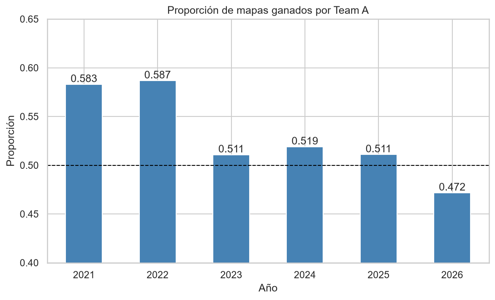

**Por qué este gráfico:** antes de modelar hay que saber si las dos clases (gana A / gana B) aparecen en proporciones parecidas; de eso depende qué tan fácil es "acertar" sin saber nada. Se usan barras por año porque interesa ver si el balance cambia en el tiempo.

**Cómo se lee:** cada barra es un año y su altura es la proporción de mapas que ganó Team A. La línea punteada marca el 50 %: una barra por encima significa que Team A gana más de la mitad. Ojo: el eje vertical empieza en 0.40, no en 0, para que la diferencia se note.

**Qué muestra:** globalmente Team A gana el 57 % de los mapas, pero el desbalance está concentrado en 2021–2022 (58 %). De 2023 en adelante el objetivo está prácticamente balanceado.

### 02.3

```python
early = maps[maps["year"] <= 2022]
is_open = early["stage"].str.contains("Open Qual")
(early.groupby(is_open.map({True: "Clasificatorio abierto", False: "Otras etapas"}))["team_a_win"]
 .agg(team_a_winrate="mean", maps="size").round(3))
```

**Qué hace:** toma los mapas de 2021–2022 y compara la proporción de victorias de Team A en clasificatorios abiertos frente al resto de etapas.

- `early["stage"].str.contains("Open Qual")`: `True` si el nombre de la etapa contiene ese texto.
- `is_open.map({True: ..., False: ...})`: cambia `True`/`False` por etiquetas legibles; se agrupa por esas etiquetas.

**Por qué:** pone a prueba la hipótesis "Team A suele ser el favorito". Si fuera falsa, las dos proporciones serían iguales.

### 02.4

```python
pd.crosstab(maps["map"], maps["year"], normalize="columns").round(2)
```

**Qué hace:** tabla cruzada de mapa por año. Con `normalize="columns"` cada columna suma 1, así que cada celda es la **proporción** de los mapas de ese año que se jugaron en ese escenario.

**Por qué:** muestra que la rotación de mapas cambia cada temporada. Se dejó como tabla (sin gráfico) porque basta leer algunas filas para ver el cambio.

### 02.5

```python
margin = (maps["team_a_score"] - maps["team_b_score"]).abs()
overtime = maps[["team_a_score", "team_b_score"]].max(axis=1) > 13

ax = margin.value_counts().sort_index().plot.bar(color="steelblue")
ax.set(title="Diferencia de rondas entre ganador y perdedor", xlabel="Diferencia de rondas", ylabel="Mapas")
plt.xticks(rotation=0)
save_fig("02_diferencia_de_rondas")
plt.show()

print(f"Diferencia mediana: {margin.median():.0f} rondas")
print(f"Mapas con overtime: {overtime.mean():.1%}")
print(f"Mapas decididos por 3 rondas o menos: {(margin <= 3).mean():.1%}")
```

**Qué hace:** calcula por cuántas rondas se ganó cada mapa, dibuja cuántos mapas hay con cada diferencia e imprime tres números resumen.

- `(A - B).abs()`: resta los marcadores y toma el valor absoluto, porque no importa quién ganó sino por cuánto.
- `overtime`: si el ganador tiene más de 13 rondas, el mapa se fue a tiempo extra.
- `margin.value_counts().sort_index()`: cuenta cuántos mapas hay con cada diferencia y ordena por la diferencia (no por la frecuencia).
- `(margin <= 3).mean()`: proporción de mapas con diferencia de 3 o menos (promedio de `True`/`False`).

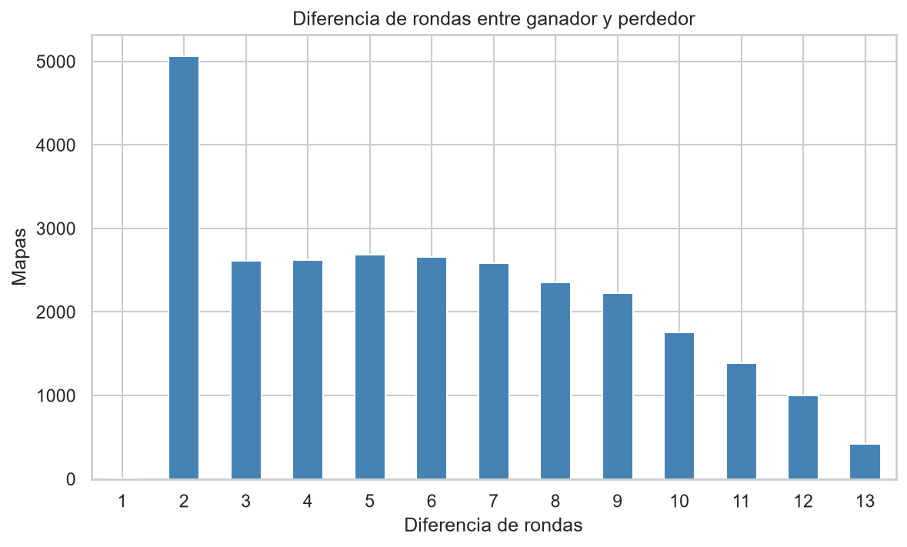

**Por qué este gráfico:** si muchos mapas se deciden por muy pocas rondas, hay un límite a lo que cualquier modelo puede acertar. Se usan barras porque la diferencia de rondas toma pocos valores enteros (de 2 a 13).

**Cómo se lee:** en el eje horizontal está la diferencia de rondas con la que terminó el mapa (2 = muy cerrado, 13 = paliza 13–0); la altura de cada barra es cuántos mapas terminaron con esa diferencia.

**Qué muestra:** la distribución es bastante plana entre 3 y 9 rondas, con un pico en 2 (que incluye todos los *overtime*, cerca del 9 % de los mapas). Casi tres de cada diez mapas se deciden por 3 rondas o menos: un par de rondas cambian el ganador. Eso anticipa un **techo de precisión**.

### 02.6

```python
team_maps = pd.concat([maps["team_a"], maps["team_b"]]).value_counts()
print(team_maps.describe().round(1).to_string())
print(f"\nEquipos con 5 mapas o menos: {(team_maps <= 5).mean():.1%}")
```

**Qué hace:** cuenta cuántos mapas jugó cada equipo en todo el dataset y resume esa cuenta.

- `pd.concat([maps["team_a"], maps["team_b"]])`: apila las dos columnas de equipos en una sola lista larga.
- `.value_counts()`: cuántas veces aparece cada equipo, es decir, cuántos mapas jugó.
- `.describe()`: resumen estadístico (promedio, mínimo, cuartiles, máximo).

**Por qué:** la mitad de los equipos jugó 4 mapas o menos, mientras que los equipos de las ligas actuales acumulan cientos. Un winrate de 100 % con 2 mapas no vale lo mismo que uno de 65 % con 200.

### 02.7

```python
# 1) una fila por equipo y mapa: se apilan Team A y Team B
team_a = maps[["game_id", "stage_block", "team_a", "team_a_win"]].set_axis(
    ["game_id", "stage_block", "team", "won"], axis=1).assign(side="a")
team_b = maps[["game_id", "stage_block", "team_b", "team_a_win"]].set_axis(
    ["game_id", "stage_block", "team", "won"], axis=1).assign(side="b")
team_b["won"] = 1 - team_b["won"]          # si ganó A, B perdió
long = pd.concat([team_a, team_b])

# 2) victorias y mapas de cada equipo en cada etapa
per_stage = (long.groupby(["team", "stage_block"])["won"].agg(["sum", "count"])
             .reset_index().sort_values(["team", "stage_block"]))

# 3) acumulado ANTES de la etapa = acumulado hasta la etapa − lo de la propia etapa
previous = per_stage.groupby("team")[["sum", "count"]].cumsum() - per_stage[["sum", "count"]]
per_stage["prior_maps"] = previous["count"]
per_stage["prior_winrate"] = previous["sum"] / previous["count"].where(previous["count"] > 0)

# 4) volver a una fila por mapa, con el dato de cada equipo en columnas
long = long.merge(per_stage[["team", "stage_block", "prior_maps", "prior_winrate"]], on=["team", "stage_block"])
wide = long.pivot(index="game_id", columns="side", values=["prior_winrate", "prior_maps"])
wide.columns = ["winrate_a", "winrate_b", "maps_a", "maps_b"]
signal = maps.merge(wide, on="game_id")
signal["winrate_diff"] = signal["winrate_a"] - signal["winrate_b"]
signal = signal[(signal["maps_a"] >= 5) & (signal["maps_b"] >= 5)]
print("Mapas con historial suficiente en ambos equipos:", len(signal))
```

**Qué hace:** calcula, para cada mapa, el winrate que traía cada equipo **antes de la etapa** y la diferencia entre ambos. Es una versión reducida de lo que hará el cuadernillo 03 con todas las variables.

Paso 1 — formato "largo":
- La tabla base tiene una fila por mapa con dos equipos. Para acumular por equipo conviene tener **una fila por equipo y mapa**. Se toman las columnas de Team A, se renombran con `.set_axis([...], axis=1)` y se marca `side="a"`; igual para Team B.
- `team_b["won"] = 1 - team_b["won"]`: la columna original dice si ganó A; para B es lo contrario.

Paso 2 — resumen por etapa:
- `groupby(["team", "stage_block"])["won"].agg(["sum", "count"])`: victorias (`sum`) y mapas jugados (`count`) de cada equipo en cada etapa.

Paso 3 — acumulado sin la etapa actual:
- `.groupby("team")[...].cumsum()`: suma acumulada etapa tras etapa, por equipo.
- Al restarle lo de la propia etapa queda lo acumulado **hasta la etapa anterior**. Así se cumple la regla de no usar partidos de la misma etapa.
- `.where(previous["count"] > 0)`: si el equipo no tiene mapas previos, deja `NaN` en vez de dividir entre cero.

Paso 4 — volver a formato "ancho":
- `merge`: pega a cada fila equipo-mapa su historial previo.
- `pivot(index="game_id", columns="side", ...)`: una fila por mapa y columnas separadas para A y B.
- `winrate_diff = winrate_a - winrate_b`: positiva si Team A llega con mejor historial.
- El filtro final exige al menos 5 mapas previos a ambos equipos.

**Por qué:** antes de construir 16 variables conviene comprobar con una sola (la más obvia) si el historial sirve de algo.

### 02.8

```python
bins = [-1, -0.3, -0.15, -0.05, 0.05, 0.15, 0.3, 1]
by_bin = signal.groupby(pd.cut(signal["winrate_diff"], bins), observed=True)["team_a_win"].agg(["mean", "size"])

ax = by_bin["mean"].plot.bar(color="seagreen")
ax.axhline(0.5, color="black", linestyle="--", linewidth=1)
ax.set(title="Probabilidad de que gane Team A según la diferencia de winrate previo",
       xlabel="Winrate previo de Team A − Team B", ylabel="Proporción de victorias de Team A")
ax.bar_label(ax.containers[0], fmt="%.2f")
plt.xticks(rotation=30)
save_fig("02_senal_winrate_previo")
plt.show()
by_bin.round(3)
```

**Qué hace:** agrupa los mapas en 7 tramos según la diferencia de winrate previo y calcula, en cada tramo, qué proporción ganó Team A.

- `pd.cut(signal["winrate_diff"], bins)`: asigna cada mapa a un intervalo; por ejemplo `(0.05, 0.15]` son los mapas donde Team A llega con entre 5 y 15 puntos más de winrate.
- `groupby(..., observed=True)`: agrupa por esos intervalos (solo los que tienen datos).
- `.agg(["mean", "size"])`: proporción de victorias de A y número de mapas en cada tramo.

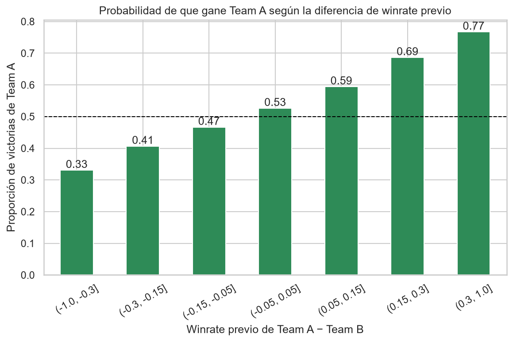

**Por qué este gráfico:** es el gráfico más importante del análisis exploratorio, porque responde si el proyecto tiene sentido: ¿el historial de un equipo dice algo sobre su siguiente mapa? Se usan barras por tramos porque así se ve directamente cómo cambia la proporción de victorias al aumentar la ventaja.

**Cómo se lee:** de izquierda a derecha, Team A llega con peor historial que su rival (tramos negativos), parejo (tramo central) o mejor (tramos positivos). La altura de cada barra es la proporción de mapas que Team A ganó en ese tramo. La línea punteada es el 50 %.

**Qué muestra:** las barras suben como una escalera: cuando Team A llega con un winrate 30 puntos peor gana un tercio de las veces; cuando llega 30 puntos mejor gana más de tres de cada cuatro. El historial sí contiene señal.

### 02.9

```python
decided = signal[signal["winrate_diff"] != 0]
better_team_won = (decided["winrate_diff"] > 0) == (decided["team_a_win"] == 1)
print(f"Acierto global de la regla: {better_team_won.mean():.1%}")
better_team_won.groupby(decided["year"]).agg(accuracy="mean", maps="size").round(3)
```

**Qué hace:** mide la exactitud de la regla "gana el que trae mejor winrate".

- `decided`: se descartan los mapas con diferencia exactamente 0, donde la regla no elige a nadie.
- `(decided["winrate_diff"] > 0) == (decided["team_a_win"] == 1)`: compara dos columnas de `True`/`False`. Es `True` cuando la regla acierta: A tenía mejor winrate y ganó, o B tenía mejor winrate y ganó.
- El promedio de esa columna es la proporción de aciertos; se calcula global y por año.

**Por qué:** este número (≈ 58 %) es la **línea base**: lo mínimo que un modelo debe superar para justificar su complejidad.

## Cuadernillo 03 — Ingeniería de variables

Archivo: `notebooks/03_ingenieria_de_variables.ipynb`

### 03.1

```python
import sys
sys.path.append("..")

import numpy as np
import pandas as pd
import matplotlib.pyplot as plt
import seaborn as sns
from sklearn.metrics import roc_auc_score

from src.config import INTERIM_DIR, PROCESSED_DIR, load_config
from src.data_loading import load_table
from src.features import FEATURES, build_dataset, team_map_stats
from src.plotting import set_style, save_fig

set_style()
config = load_config()
maps = pd.read_csv(INTERIM_DIR / "maps.csv")
overview = load_table("matches/overview.csv")
eco_stats = load_table("matches/eco_stats.csv")
draft = load_table("matches/draft_phase.csv")
print(maps.shape, overview.shape, eco_stats.shape, draft.shape)
```

**Qué hace:** importa las librerías y carga las cuatro tablas que se necesitan: la tabla base de mapas (cuadernillo 01) y las tres tablas crudas de donde salen las estadísticas (jugadores, economía y vetos).

- `numpy` (`np`): operaciones numéricas. `seaborn` (`sns`): gráficos estadísticos, aquí para el mapa de calor.
- `roc_auc_score`: función de scikit-learn que calcula el AUC (se explica en la sección 1).
- `FEATURES`: la lista con los nombres de las 16 variables candidatas, definida en `src/features.py`.
- `build_dataset` y `team_map_stats`: las dos funciones que construyen las variables; su código se explica en la Parte 3 de este documento.

### 03.2

```python
long = team_map_stats(maps, overview, eco_stats)

same_map = long.pivot(index="game_id", columns="side", values="acs")
same_map["acs_diff"] = same_map["a"] - same_map["b"]
same_map = same_map.join(maps.set_index("game_id")["team_a_win"]).dropna()

leak_auc = roc_auc_score(same_map["team_a_win"], same_map["acs_diff"])
leak_acc = ((same_map["acs_diff"] > 0) == (same_map["team_a_win"] == 1)).mean()
print(f"AUC del ACS del mismo mapa: {leak_auc:.3f}")
print(f"'Gana el equipo con más ACS en ese mapa' acierta el {leak_acc:.1%}")
```

**Qué hace:** mide qué tan bien se "predice" el ganador usando el ACS **del mismo mapa** que se quiere predecir.

- `team_map_stats(...)`: devuelve una tabla con dos filas por mapa (una por equipo) y las estadísticas promedio de sus jugadores en ese mapa.
- `long.pivot(index="game_id", columns="side", values="acs")`: pasa a una fila por mapa con dos columnas, `a` y `b`, que contienen el ACS de cada equipo.
- `acs_diff = a - b`: positiva si Team A tuvo mejor ACS en ese mapa.
- `.join(maps.set_index("game_id")["team_a_win"])`: agrega quién ganó, uniendo por `game_id`. `.dropna()` descarta los mapas sin estadística.
- `roc_auc_score(objetivo, variable)`: el **AUC** es la probabilidad de que, tomando al azar un mapa que ganó A y uno que perdió, la variable sea mayor en el que ganó. 0.5 = la variable no dice nada; 1.0 = separa perfecto.
- `leak_acc`: exactitud de la regla "gana el que tuvo más ACS en ese mapa".

**Por qué:** es la demostración de la **fuga de datos**. El resultado (AUC 0.986, 93.6 % de acierto) parece excelente, pero es trampa: el ACS se calcula con lo que pasó durante el mapa, así que es una consecuencia del resultado, no una causa. Antes del partido ese dato no existe.

### 03.3

```python
fig, ax = plt.subplots()
ax.hist(same_map.loc[same_map["team_a_win"] == 1, "acs_diff"], bins=40, alpha=0.6, label="Ganó Team A")
ax.hist(same_map.loc[same_map["team_a_win"] == 0, "acs_diff"], bins=40, alpha=0.6, label="Ganó Team B")
ax.set(title="ACS del mismo mapa: Team A − Team B (fuga de datos)",
       xlabel="Diferencia de ACS en el mapa que se quiere predecir", ylabel="Mapas")
ax.legend()
save_fig("03_fuga_acs_mismo_mapa")
plt.show()
```

**Qué hace:** dibuja dos histogramas superpuestos de la diferencia de ACS: uno con los mapas que ganó Team A y otro con los que ganó Team B.

- `plt.subplots()`: crea la figura y los ejes (`ax`) sobre los que se dibuja.
- `same_map.loc[condición, "acs_diff"]`: filas que cumplen la condición, columna `acs_diff`.
- `bins=40`: divide el eje horizontal en 40 tramos. `alpha=0.6`: transparencia, para que se vean los dos histogramas donde se cruzan.
- `ax.legend()`: muestra la leyenda con las etiquetas (`label`).

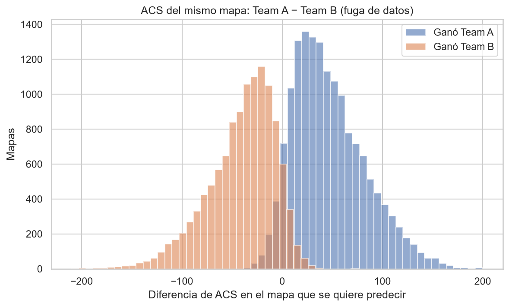

**Por qué este gráfico:** para *ver* la fuga de datos y no solo leer un número. Un histograma por clase muestra si una variable separa a ganadores de perdedores.

**Cómo se lee:** el eje horizontal es la diferencia de ACS entre Team A y Team B en ese mismo mapa; la altura es cuántos mapas hay en cada tramo. Un color son los mapas que ganó Team A y el otro los que ganó Team B. Cuanto menos se pisen las dos "montañas", mejor separa la variable.

**Qué muestra:** las dos montañas casi no se tocan: si A tuvo más ACS, casi siempre ganó. No es que la variable sea buena prediciendo: es que **describe el resultado**. Por eso la regla del proyecto es que las estadísticas de un mapa solo pueden usarse para describir mapas *posteriores*.

### 03.4

```python
dataset = build_dataset(maps, overview, eco_stats, draft,
                        window=config["recent_window"], seed=config["seed"])
print(dataset.shape)
dataset.tail(3).T
```

**Qué hace:** construye el dataset de modelado completo: una fila por mapa, con las 16 variables y el objetivo.

- `window=config["recent_window"]`: cuántos mapas cuenta la "forma reciente" (10, según `config.yaml`).
- `seed=config["seed"]`: semilla del intercambio aleatorio de Team A y Team B (sección 4); con la misma semilla el resultado siempre es igual.
- `dataset.tail(3).T`: las tres últimas filas, transpuestas (`.T`) para leer las variables hacia abajo en vez de hacia la derecha.

**Por qué:** el cálculo es largo y se usa una sola vez, así que vive en una función de `src/features.py`. Su funcionamiento interno se explica bloque por bloque en la Parte 3.

### 03.5

```python
example = dataset[dataset["match_id"] == 378836].iloc[0]

def prior_record(team, stage_block):
    """Mapas del equipo en etapas anteriores a `stage_block`."""
    played = maps[((maps["team_a"] == team) | (maps["team_b"] == team)) & (maps["stage_block"] < stage_block)]
    won = ((played["team_a"] == team) & (played["team_a_win"] == 1)) | \
          ((played["team_b"] == team) & (played["team_a_win"] == 0))
    return len(played), won.mean(), played["match_id"].max()

n_a, winrate_a, last_a = prior_record(example["team_a"], example["stage_block"])
n_b, winrate_b, last_b = prior_record(example["team_b"], example["stage_block"])
print(f"{example['team_a']}: {n_a} mapas previos, winrate {winrate_a:.4f}")
print(f"{example['team_b']}: {n_b} mapas previos, winrate {winrate_b:.4f}")
print(f"Diferencia a mano:        {winrate_a - winrate_b:.6f}")
print(f"Diferencia en el dataset: {example['diff_winrate']:.6f}")
print(f"Último partido usado: {max(last_a, last_b)}  |  primer partido de esta etapa: {example['stage_block']}")

assert np.isclose(winrate_a - winrate_b, example["diff_winrate"])
assert max(last_a, last_b) < example["stage_block"]
```

**Qué hace:** recalcula a mano una variable (`diff_winrate`) para un mapa concreto y comprueba que coincide con lo que produjo `build_dataset`.

- `dataset[dataset["match_id"] == 378836].iloc[0]`: filtra el partido con ese ID y toma su primera fila (`.iloc[0]`), que es el primer mapa.
- `prior_record(team, stage_block)`: función corta que busca en la tabla base todos los mapas de un equipo (como A **o** como B) en etapas anteriores (`stage_block` menor), y devuelve cuántos son, qué proporción ganó y el ID del más reciente.
- `won`: el equipo ganó si era Team A y ganó A, **o** si era Team B y perdió A.
- `np.isclose(x, y)`: compara dos decimales tolerando diferencias minúsculas de redondeo.
- Los `assert` detienen el cuadernillo si (1) el valor a mano no coincide con el del dataset o (2) el historial incluyó algún partido de la misma etapa.

**Por qué:** es la prueba, con un caso real y fácil de seguir, de que la variable se calcula como se dijo y de que no usa información del futuro. Además, el archivo `tests/test_features.py` verifica lo mismo de forma automática con datos pequeños inventados.

### 03.6

```python
check = maps.groupby("year")["team_a_win"].mean().to_frame("antes")
check["despues"] = dataset.groupby("year")["team_a_win"].mean()
print(f"Global: antes {maps['team_a_win'].mean():.3f} → después {dataset['team_a_win'].mean():.3f}")
check.round(3)
```

**Qué hace:** compara la proporción de victorias de Team A por año antes (tabla base) y después (dataset) del intercambio aleatorio.

- `.to_frame("antes")`: convierte la serie en tabla con una columna llamada `antes`; luego se le agrega la columna `despues`.

**Por qué:** confirma que el intercambio funcionó: el objetivo pasa de 57 % a 50 % en todos los años. Desde aquí, cualquier acierto por encima del 50 % se debe a las variables y no a la posición.

### 03.7

```python
missing = dataset[FEATURES].isna().groupby(dataset["year"]).mean().T
plt.figure(figsize=(8, 6.5))
sns.heatmap(missing, annot=True, fmt=".0%", cmap="Reds", cbar=False, vmin=0, vmax=1)
plt.title("Proporción de valores faltantes por variable y año")
plt.xlabel("Año"); plt.ylabel("")
save_fig("03_valores_faltantes")
plt.show()
```

**Qué hace:** calcula qué proporción de los mapas de cada año tiene vacía cada variable y lo dibuja como mapa de calor.

- `dataset[FEATURES].isna()`: tabla de `True`/`False` (¿falta el dato?).
- `.groupby(dataset["year"]).mean()`: promedio por año = proporción de faltantes. `.T` transpone para dejar las variables como filas y los años como columnas.
- `sns.heatmap(...)`: `annot=True` escribe el número en cada celda; `fmt=".0%"` lo muestra como porcentaje sin decimales; `cmap="Reds"` usa rojos (más oscuro = más faltantes); `vmin=0, vmax=1` fija la escala de 0 a 100 %.

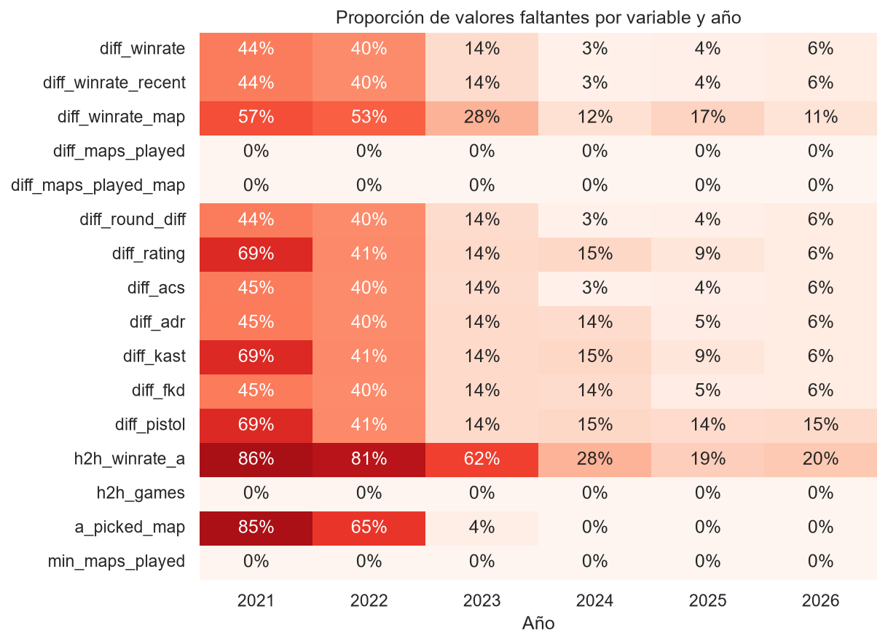

**Por qué este gráfico:** hay 16 variables y 6 años, es decir, 96 números. Un mapa de calor permite ver de un vistazo dónde se concentran los faltantes, algo que en una tabla sin color costaría mucho más.

**Cómo se lee:** cada fila es una variable y cada columna un año. El número de la celda es el porcentaje de mapas de ese año donde la variable está vacía; cuanto más oscuro el rojo, más datos faltan.

**Qué muestra:**

- Las variables de rendimiento (`diff_winrate`, `diff_round_diff`, `diff_acs`…) faltan en 40–45 % de los mapas de 2021–2022 y en menos del 15 % desde 2023: son los equipos que solo jugaron un clasificatorio abierto y no tienen etapas anteriores.
- `diff_rating`, `diff_kast` y `diff_pistol` faltan más en 2021: vlr.gg no registraba esas estadísticas en muchos partidos de ese año.
- `h2h_winrate_a` falta en la mayoría de las filas: casi todos los enfrentamientos son la primera vez que esos dos equipos se cruzan.
- Los conteos (`diff_maps_played`, `h2h_games`, `min_maps_played`) nunca faltan: sin historial valen 0.

### 03.8

```python
dataset.to_csv(PROCESSED_DIR / "dataset.csv", index=False, float_format="%.5f")
print("Guardado:", dataset.shape)
dataset[FEATURES].describe().T[["count", "mean", "std", "min", "max"]].round(2)
```

**Qué hace:** guarda el dataset de modelado en `data/processed/dataset.csv` y muestra un resumen de las 16 variables.

- `float_format="%.5f"`: guarda los decimales con 5 cifras, para que el archivo no pese de más.
- `.describe().T[[...]]`: resumen estadístico, transpuesto, quedándose con cinco columnas.

**Por qué:** los cuadernillos de selección y modelado leen este archivo; así no necesitan los datos crudos (1.3 GB). En el resumen se ve que las diferencias están centradas en 0 (promedio ≈ 0), como debe ser después del intercambio aleatorio.

## Cuadernillo 04 — Partición de los datos y selección de variables

Archivo: `notebooks/04_seleccion_de_variables.ipynb`

### 04.1

```python
import sys
sys.path.append("..")

import numpy as np
import pandas as pd
import matplotlib.pyplot as plt
import seaborn as sns
import yaml
from sklearn.metrics import roc_auc_score

from src.config import CONFIG_PATH, PROCESSED_DIR, TABLES_DIR, load_config
from src.evaluation import temporal_split
from src.features import FEATURES
from src.plotting import set_style, save_fig

set_style()
config = load_config()
TARGET = config["target"]
dataset = pd.read_csv(PROCESSED_DIR / "dataset.csv")
```

**Qué hace:** importa las librerías y lee el dataset de modelado que guardó el cuadernillo 03.

- `yaml`: librería para leer y escribir el archivo de configuración `config.yaml`.
- `temporal_split`: la función del proyecto que separa los datos por año (sección 1).
- `TARGET = config["target"]`: el nombre de la columna objetivo (`team_a_win`) se lee de la configuración; se escribe en mayúsculas por convención para indicar que es una constante.

### 04.2

```python
train, val, test = temporal_split(dataset, config["split"])
pd.DataFrame({
    "años": [config["split"][part] for part in ("train", "val", "test")],
    "mapas": [len(train), len(val), len(test)],
    "team_a_win": [part[TARGET].mean().round(3) for part in (train, val, test)],
}, index=["entrenamiento", "validación", "prueba"])
```

**Qué hace:** separa el dataset en tres tablas (entrenamiento, validación y prueba) y muestra un resumen: qué años tiene cada una, cuántos mapas y la proporción de victorias de Team A.

- `temporal_split(dataset, config["split"])`: devuelve tres DataFrames. `config["split"]` es un diccionario `{train: [2021, 2022, 2023, 2024], val: [2025], test: [2026]}`. Por dentro, la función solo filtra las filas cuyo año está en cada lista.
- `train, val, test = ...`: Python reparte los tres resultados en tres variables.
- `[len(train), len(val), len(test)]`: número de filas de cada conjunto.
- `[part[TARGET].mean().round(3) for part in (...)]`: una lista por comprensión; para cada conjunto calcula la proporción de victorias de Team A.

**Por qué:** es la respuesta a "cómo se separaron los datos": por año, no al azar. La tabla confirma que los tres conjuntos están balanceados (cerca de 0.50) y deja ver el tamaño de cada uno: 25 210, 1 272 y 886 mapas.

### 04.3

```python
rows = []
for feature in FEATURES:
    known = train[[feature, TARGET]].dropna()
    rows.append({
        "feature": feature,
        "corr": known[feature].corr(known[TARGET]),
        "auc": roc_auc_score(known[TARGET], known[feature]),
        "missing": train[feature].isna().mean(),
    })
univariate = pd.DataFrame(rows).set_index("feature").sort_values("auc", ascending=False)

ax = univariate["auc"].sort_values().plot.barh(color="steelblue", figsize=(8, 6))
ax.axvline(0.5, color="black", linestyle="--", linewidth=1)
ax.set(title="AUC univariado de cada variable (entrenamiento)", xlabel="AUC", ylabel="", xlim=(0.45, 0.70))
save_fig("04_auc_univariado")
plt.show()
univariate.round(3)
```

**Qué hace:** recorre las 16 variables y, para cada una, calcula su correlación con el objetivo, su AUC y su proporción de faltantes. Luego dibuja el AUC en barras horizontales.

- `for feature in FEATURES:`: repite el bloque una vez por variable.
- `train[[feature, TARGET]].dropna()`: se queda con las dos columnas y descarta las filas donde la variable está vacía (no se puede medir relación con un dato que no existe).
- `known[feature].corr(known[TARGET])`: correlación de Pearson entre la variable y el objetivo.
- `roc_auc_score(objetivo, variable)`: AUC de la variable usada sola, sin modelo.
- `train[feature].isna().mean()`: proporción de faltantes sobre **todas** las filas de entrenamiento.
- `.set_index("feature").sort_values("auc", ascending=False)`: usa el nombre de la variable como índice y ordena de mayor a menor AUC.
- `.plot.barh(...)`: barras horizontales (más cómodas cuando las etiquetas son nombres largos). `ax.axvline(0.5, ...)`: línea vertical en 0.5.

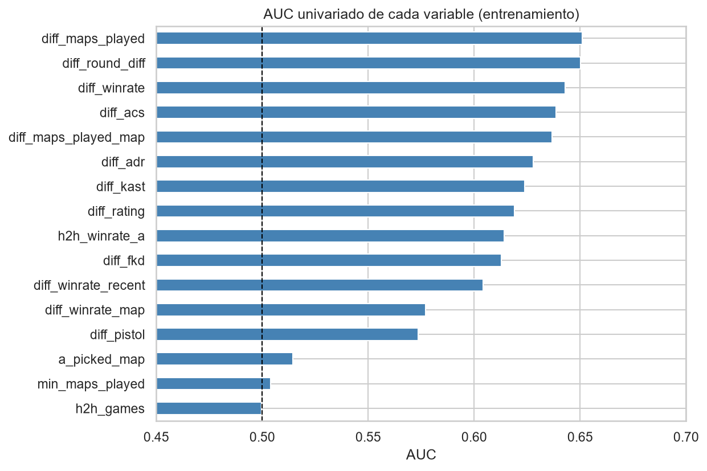

**Por qué este gráfico:** para decidir qué variables conservar hay que compararlas con una misma medida. El AUC univariado dice, con un solo número por variable, qué tanto separa a ganadores de perdedores. Barras horizontales ordenadas permiten ver el ranking de inmediato.

**Cómo se lee:** cada barra es una variable y su largo es el AUC. La línea punteada en 0.5 es "no dice nada" (como lanzar una moneda). Cuanto más a la derecha de esa línea llega la barra, más información tiene la variable por sí sola.

**Qué muestra:**

- Las variables de rendimiento general (`diff_round_diff`, `diff_winrate`, `diff_acs`) y la de experiencia (`diff_maps_played`) son las más informativas, con AUC entre 0.64 y 0.65.
- `diff_winrate_recent` (últimos 10 mapas) rinde menos que el winrate de todo el historial: diez mapas son pocos y el resultado es más ruidoso.
- `min_maps_played` y `h2h_games` tienen AUC 0.5. Es lo esperado: no dicen *quién* es mejor, solo cuánta información hay.
- Ninguna variable pasa de 0.65: la señal es modesta y está repartida.

### 04.4

```python
picked = train.dropna(subset=["a_picked_map"]).groupby("a_picked_map")[TARGET].agg(team_a_winrate="mean", maps="size")
picked.index = picked.index.map({-1.0: "Lo eligió Team B", 0.0: "Mapa decisivo", 1.0: "Lo eligió Team A"})
picked.round(3)
```

**Qué hace:** agrupa los mapas según quién eligió el mapa y calcula la proporción de victorias de Team A en cada caso.

- `dropna(subset=["a_picked_map"])`: descarta solo las filas donde esa columna está vacía.
- `picked.index.map({...})`: reemplaza los valores −1, 0 y 1 del índice por textos legibles.

**Por qué:** muestra que elegir el mapa da una ventaja pequeña (quien lo elige gana cerca del 51.5 %). Es poca señal, pero es información legítima y disponible antes del partido, así que se conserva.

### 04.5

```python
corr = train[FEATURES].corr()
plt.figure(figsize=(11, 9))
sns.heatmap(corr, annot=True, fmt=".2f", cmap="coolwarm", center=0, vmin=-1, vmax=1,
            annot_kws={"size": 8}, cbar=False)
plt.title("Correlación entre variables (entrenamiento)")
save_fig("04_correlacion_variables")
plt.show()

pairs = corr.where(np.triu(np.ones(corr.shape, dtype=bool), k=1)).stack()
pairs[pairs.abs() >= 0.75].sort_values(ascending=False).round(2).to_frame("correlación")
```

**Qué hace:** calcula la correlación entre cada par de variables, la dibuja como mapa de calor y lista los pares con correlación de 0.75 o más.

- `train[FEATURES].corr()`: matriz de correlaciones 16 × 16; la celda (i, j) es la correlación entre la variable i y la j.
- `sns.heatmap(...)`: `cmap="coolwarm"` pinta rojo lo positivo y azul lo negativo; `center=0` pone el color neutro en 0; `annot_kws={"size": 8}` reduce el tamaño de los números para que quepan.
- `np.triu(np.ones(corr.shape, dtype=bool), k=1)`: crea una máscara con `True` solo en el triángulo superior de la matriz (sin la diagonal). La matriz es simétrica, así que con medio triángulo cada par aparece una sola vez.
- `corr.where(máscara).stack()`: deja solo ese triángulo y lo convierte en una lista larga de pares.
- `pairs[pairs.abs() >= 0.75]`: filtra los pares muy correlacionados (en valor absoluto).

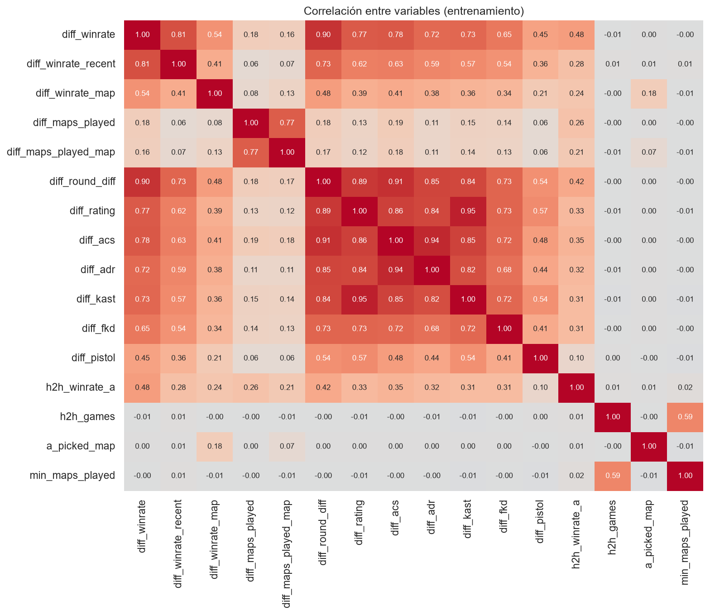

**Por qué este gráfico:** con 16 variables hay 120 pares posibles. El mapa de calor de correlaciones es la forma estándar de detectar, de un vistazo, grupos de variables que cuentan la misma historia.

**Cómo se lee:** la misma lista de variables está en filas y columnas. Cada celda es la correlación entre dos variables: cerca de 1 (rojo intenso) significa que suben y bajan juntas, cerca de 0 (color claro) que no tienen relación, y negativo (azul) que una sube cuando la otra baja. La diagonal siempre vale 1 (cada variable consigo misma).

**Qué muestra:** hay un bloque rojo de variables de rendimiento muy correlacionadas entre sí:

- **`diff_rating` y `diff_kast` (0.95):** el *rating* de vlr.gg es una fórmula que ya incorpora el KAST. Se conserva `diff_kast` (estadística directa) y se descarta `diff_rating`.
- **`diff_acs` y `diff_adr` (0.94):** el ACS se calcula sobre todo a partir del daño. Se conserva `diff_acs` (mayor AUC y menos faltantes).
- **`diff_maps_played` y `diff_maps_played_map` (0.77):** la experiencia en un mapa concreto es casi una fracción de la experiencia total. Se conserva la general.
- **`diff_round_diff` con `diff_winrate` (0.90) y con `diff_acs` (0.91):** correlación alta, pero son conceptos distintos (margen de victoria, frecuencia de victoria, nivel individual) y las tres están entre las más informativas. Se conservan.

### 04.6

```python
decisions = {
    "diff_winrate": ("conservar", "Señal alta; medida directa de qué tan seguido gana el equipo"),
    "diff_winrate_recent": ("conservar", "Única variable de forma reciente; capta rachas que el historial completo diluye"),
    "diff_winrate_map": ("conservar", "Única variable específica del mapa que se juega"),
    "diff_maps_played": ("conservar", "Mejor AUC univariado; nunca falta"),
    "diff_maps_played_map": ("descartar", "Redundante con diff_maps_played (r = 0.77) y con menos señal"),
    "diff_round_diff": ("conservar", "Mayor correlación con el objetivo; mide el margen, no solo el resultado"),
    "diff_rating": ("descartar", "Redundante con diff_kast (r = 0.95); el rating es una fórmula derivada"),
    "diff_acs": ("conservar", "Mejor indicador del nivel individual; buena cobertura"),
    "diff_adr": ("descartar", "Redundante con diff_acs (r = 0.94), con menos señal y más faltantes"),
    "diff_kast": ("conservar", "Mide consistencia del equipo ronda a ronda; se prefiere al rating"),
    "diff_fkd": ("conservar", "Duelos de apertura: aspecto táctico distinto al resto"),
    "diff_pistol": ("descartar", "Señal baja (AUC 0.57) y 55 % de faltantes"),
    "h2h_winrate_a": ("conservar", "Poca cobertura, pero aporta información propia del enfrentamiento"),
    "h2h_games": ("descartar", "Sin señal propia; el faltante de h2h_winrate_a ya indica que no hay enfrentamientos previos"),
    "a_picked_map": ("conservar", "Señal pequeña pero legítima y conocida antes del partido; completa desde 2024"),
    "min_maps_played": ("conservar", "No indica quién gana, pero dice cuánta evidencia respalda a las demás variables"),
}
table = univariate.join(pd.DataFrame(decisions, index=["decision", "reason"]).T)
table.to_csv(TABLES_DIR / "04_variables.csv")
selected = [f for f in FEATURES if decisions[f][0] == "conservar"]
print(f"Se conservan {len(selected)} de {len(FEATURES)} variables")
table[["auc", "missing", "decision", "reason"]].round(3)
```

**Qué hace:** deja por escrito la decisión (conservar o descartar) y el motivo de cada variable, la une con los números de la sección 2 y arma la lista final.

- `decisions`: un diccionario donde la clave es el nombre de la variable y el valor es una tupla `(decisión, motivo)`.
- `pd.DataFrame(decisions, index=["decision", "reason"]).T`: convierte el diccionario en una tabla con una fila por variable y dos columnas.
- `univariate.join(...)`: pega esas dos columnas a la tabla de AUC y faltantes, emparejando por el nombre de la variable (el índice).
- `selected = [f for f in FEATURES if decisions[f][0] == "conservar"]`: lista por comprensión con las variables cuya decisión es "conservar". `decisions[f][0]` es el primer elemento de la tupla.

**Por qué:** las decisiones las toma una persona mirando los gráficos, no un algoritmo; escribirlas en el código las deja documentadas junto a los números que las respaldan, y la tabla queda guardada en `reports/tables/04_variables.csv`.

### 04.7

```python
config["features"] = selected
CONFIG_PATH.write_text(yaml.safe_dump(config, sort_keys=False, allow_unicode=True), encoding="utf-8")
load_config()["features"]
```

**Qué hace:** guarda la lista de variables seleccionadas en `config/config.yaml` y la vuelve a leer para confirmar que quedó bien.

- `config["features"] = selected`: agrega (o reemplaza) la entrada `features` del diccionario de configuración.
- `yaml.safe_dump(config, ...)`: convierte el diccionario a texto en formato YAML. `sort_keys=False` conserva el orden original; `allow_unicode=True` permite tildes.
- `CONFIG_PATH.write_text(...)`: escribe ese texto en el archivo.

**Por qué:** los cuadernillos de modelado leen la lista desde la configuración; así todos usan exactamente las mismas 11 variables sin copiarlas a mano.

## Cuadernillo 05 — Modelo 1: regresión logística

Archivo: `models/05_modelo_regresion_logistica.ipynb`

### 05.1

```python
import sys
sys.path.append("..")

import numpy as np
import pandas as pd
import matplotlib.pyplot as plt
import yaml
from sklearn.impute import SimpleImputer
from sklearn.linear_model import LogisticRegression
from sklearn.pipeline import make_pipeline
from sklearn.preprocessing import StandardScaler

from src.config import CONFIG_PATH, PROCESSED_DIR, TABLES_DIR, load_config
from src.evaluation import accuracy_interval, evaluate, temporal_split
from src.plotting import set_style, save_fig

set_style()
config = load_config()
FEATURES, TARGET = config["features"], config["target"]

dataset = pd.read_csv(PROCESSED_DIR / "dataset.csv")
train, val, test = temporal_split(dataset, config["split"])
X_val, y_val = val[FEATURES], val[TARGET]
print(f"Entrenamiento: {len(train)} mapas | Validación: {len(val)} mapas | Variables: {len(FEATURES)}")
```

**Qué hace:** importa lo necesario, lee el dataset y lo separa por año, igual que en el cuadernillo 04.

- `LogisticRegression`: el modelo. `SimpleImputer`: rellena valores faltantes. `StandardScaler`: pone las variables en la misma escala. `make_pipeline`: encadena esos pasos en un solo objeto.
- `accuracy_interval`, `evaluate`, `temporal_split`: funciones del proyecto en `src/evaluation.py` (intervalo de confianza, métricas y partición por año).
- `FEATURES, TARGET = config["features"], config["target"]`: asignación doble; la lista de 11 variables y el nombre de la columna objetivo.
- `X_val, y_val = val[FEATURES], val[TARGET]`: por convención, `X` son las variables (lo que el modelo recibe) e `y` es el objetivo (lo que debe predecir). Aquí, las de validación.

### 05.2

```python
ejemplo = pd.DataFrame({"gano_team_a": [1, 1, 0], "prob_predicha_team_a": [0.9, 0.6, 0.8]})
prob_de_lo_que_paso = np.where(ejemplo["gano_team_a"] == 1,
                               ejemplo["prob_predicha_team_a"], 1 - ejemplo["prob_predicha_team_a"])
ejemplo["penalizacion"] = -np.log(prob_de_lo_que_paso)
print(ejemplo.round(3).to_string(index=False))
print(f"\nLog loss (promedio de las penalizaciones): {ejemplo['penalizacion'].mean():.3f}")
print(f"Penalización de responder siempre 50 %:    {-np.log(0.5):.3f}")
```

**Qué hace:** calcula el log loss a mano con tres predicciones inventadas, para ver de dónde sale el número.

- `ejemplo`: tres mapas. En el primero el modelo dijo "90 % gana A" y ganó A; en el segundo dijo 60 % y ganó A; en el tercero dijo 80 % y ganó **B**.
- `np.where(condición, valor_si, valor_no)`: si ganó A, la probabilidad que el modelo le dio "a lo que pasó" es la predicha; si ganó B, es `1 − predicha` (en el tercer mapa, 0.2).
- `-np.log(...)`: logaritmo natural con signo cambiado. Convierte una probabilidad alta (0.9) en una penalización pequeña (0.105) y una baja (0.2) en una grande (1.609).
- El promedio de las tres penalizaciones es el log loss.
- `-np.log(0.5)`: quien responde siempre "50 %" recibe 0.693 en todos los mapas.

**Por qué:** el log loss es el criterio principal del proyecto y es la métrica menos intuitiva. Verlo calculado a mano deja claras dos ideas: (1) acertar con seguridad se premia, pero equivocarse con seguridad se castiga muchísimo, y (2) **0.693 es la referencia**: un modelo con log loss mayor que 0.693 da probabilidades peores que no saber nada.

### 05.3

```python
def make_logistic():
    return make_pipeline(SimpleImputer(strategy="median", add_indicator=True), StandardScaler(),
                         LogisticRegression(max_iter=2000))

first_try = make_logistic().fit(train[FEATURES], train[TARGET])
first_proba = first_try.predict_proba(X_val)[:, 1]
pd.Series(evaluate(y_val, first_proba)).round(4)
```

**Qué hace:** define cómo se construye el modelo, lo entrena con todo el entrenamiento y lo mide en validación.

- `make_logistic()`: función que devuelve un modelo nuevo, sin entrenar. Se define como función porque se va a crear varias veces. El modelo es una cadena (*pipeline*) de tres pasos que se ejecutan en orden:
  1. `SimpleImputer(strategy="median", add_indicator=True)`: reemplaza cada faltante por la mediana de su variable y agrega columnas 0/1 que indican dónde faltaba el dato.
  2. `StandardScaler()`: resta el promedio y divide por la desviación estándar, para que todas las variables queden en la misma escala (una diferencia de mapas va de −494 a 494; una de winrate, de −1 a 1).
  3. `LogisticRegression(max_iter=2000)`: el modelo. Calcula una suma ponderada de las variables y la convierte en una probabilidad entre 0 y 1. `max_iter` es el máximo de pasos que puede dar para encontrar los pesos.
- `.fit(X, y)`: **entrena**: busca los pesos que mejor explican los resultados de entrenamiento.
- `.predict_proba(X_val)`: devuelve dos columnas, la probabilidad de la clase 0 (gana B) y de la clase 1 (gana A). `[:, 1]` toma todas las filas de la segunda columna: P(gana Team A).
- `evaluate(y_val, first_proba)`: devuelve un diccionario con exactitud, ROC-AUC y log loss.

**Por qué:** es el punto de partida natural. El resultado enseña algo: exactitud y AUC normales, pero log loss de 0.84, **peor que no saber nada** (0.693).

### 05.4

```python
fig, ax = plt.subplots()
ax.hist(first_proba, bins=30, color="indianred")
ax.set(title="Primer intento: probabilidades predichas en validación", xlabel="P(gana Team A)", ylabel="Mapas")
save_fig("05_probabilidades_primer_intento")
plt.show()

check = pd.DataFrame({"prob": first_proba, "gano_team_a": y_val.to_numpy()})
(check.groupby(pd.cut(check["prob"], [0, 0.1, 0.3, 0.5, 0.7, 0.9, 1]), observed=True)
 .agg(mapas=("prob", "size"), prob_media=("prob", "mean"), gano_team_a=("gano_team_a", "mean")).round(2))
```

**Qué hace:** dibuja un histograma de las probabilidades que predijo el primer modelo y, en una tabla, compara lo que el modelo dijo con lo que realmente pasó.

- `ax.hist(first_proba, bins=30)`: reparte las 1 272 probabilidades en 30 tramos y cuenta cuántos mapas caen en cada uno.
- `check`: tabla con la probabilidad predicha y el resultado real de cada mapa. `.to_numpy()` quita el índice de pandas para que las dos columnas se alineen por posición.
- `pd.cut(check["prob"], [0, 0.1, 0.3, ...])`: agrupa los mapas por tramos de probabilidad predicha.
- `.agg(...)`: en cada tramo, cuántos mapas hay, la probabilidad promedio que dio el modelo (`prob_media`) y la proporción que **realmente** ganó Team A (`gano_team_a`).

**Por qué:** si las probabilidades fueran buenas, `prob_media` y `gano_team_a` serían parecidas en todos los tramos. No lo son: ahí está la causa del log loss tan malo.

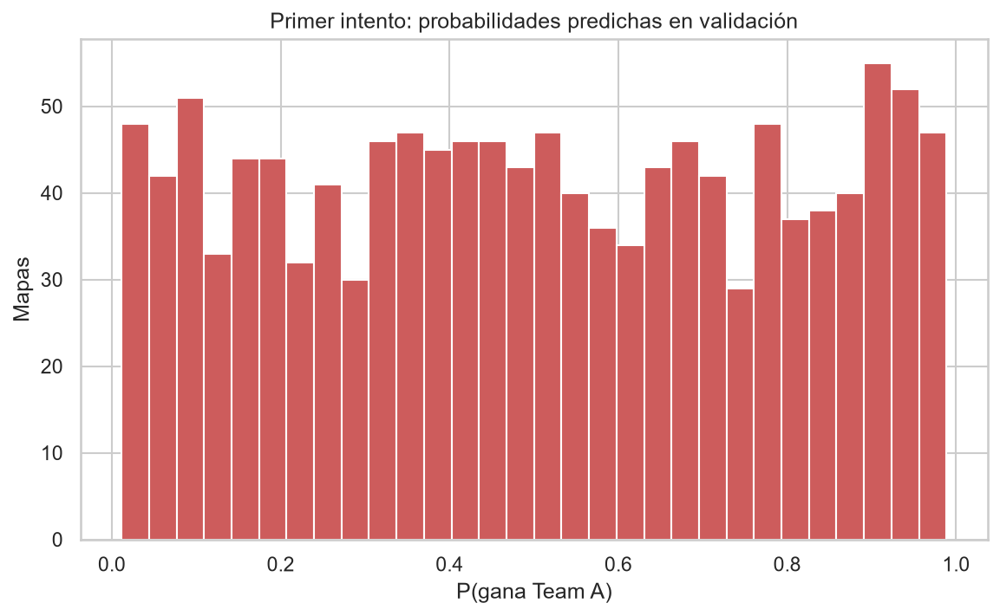

**Por qué este gráfico:** el log loss dice que las probabilidades son malas, pero no dice *cómo* son. Un histograma muestra qué probabilidades entrega el modelo y con qué frecuencia.

**Cómo se lee:** el eje horizontal es la probabilidad que el modelo le dio a Team A (0 = "seguro gana B", 1 = "seguro gana A"); la altura es cuántos mapas recibieron esa probabilidad. En un problema parejo como este se esperaría una montaña alrededor de 0.5.

**Qué muestra:** el modelo reparte probabilidades por todo el rango, desde casi 0 hasta casi 1, como si muchos partidos estuvieran decididos de antemano. La tabla de abajo lo desmiente: cuando el modelo dice "94 %" (último tramo), Team A gana solo el 68 % de las veces; cuando dice "6 %" (primer tramo), gana el 43 %. El modelo **se pasa de confiado**, y el log loss castiga justamente eso.

### 05.5

```python
shift = pd.DataFrame({
    "std_train": train[FEATURES].std(), "std_val": val[FEATURES].std(),
    "median_train": train[FEATURES].median(), "median_val": val[FEATURES].median(),
}).round(2)
print(f"Mapas con ambos equipos con 30+ mapas previos → entrenamiento: "
      f"{(train['min_maps_played'] >= 30).mean():.1%} | validación: {(val['min_maps_played'] >= 30).mean():.1%}")
shift.loc[["diff_maps_played", "min_maps_played", "diff_winrate", "diff_round_diff", "diff_acs"]]
```

**Qué hace:** compara la dispersión (desviación estándar) y la mediana de las variables en entrenamiento y en validación, e imprime qué proporción de mapas tiene a ambos equipos con 30 o más mapas previos en cada conjunto.

- `train[FEATURES].std()`: desviación estándar de cada variable (qué tan dispersos están sus valores).
- `shift.loc[[...]]`: muestra solo las cinco filas más ilustrativas.

**Por qué:** busca la causa del problema. La variable de experiencia (`diff_maps_played`) tiene en validación una dispersión casi cuatro veces mayor que en entrenamiento, y solo el 20 % de los mapas de entrenamiento son cruces entre equipos con historial, frente al 85 % en validación. **El entrenamiento y la validación describen dos mundos distintos.**

### 05.6

```python
rows = []
for threshold in [0, 5, 10, 20, 30, 50, 80]:
    subset = train[train["min_maps_played"] >= threshold]
    model = make_logistic().fit(subset[FEATURES], subset[TARGET])
    rows.append({"min_maps_played >=": threshold, "train_maps": len(subset),
                 **evaluate(y_val, model.predict_proba(X_val)[:, 1])})
sensitivity = pd.DataFrame(rows).set_index("min_maps_played >=")
sensitivity.to_csv(TABLES_DIR / "05_sensibilidad_umbral_historial.csv")

ax = sensitivity["log_loss"].plot(marker="o", color="indianred")
ax.axhline(0.693, color="black", linestyle="--", linewidth=1, label="No saber nada (0.693)")
ax.set(title="Curva de log loss en validación según el historial mínimo exigido al entrenar",
       xlabel="Mapas previos mínimos de ambos equipos", ylabel="Log loss (menor es mejor)")
ax.legend()
save_fig("05_curva_log_loss_historial")
plt.show()
sensitivity.round(4)
```

**Qué hace:** entrena siete veces el mismo modelo, cada vez con un conjunto de entrenamiento más exigente (ambos equipos con al menos 0, 5, 10, 20, 30, 50 u 80 mapas previos), mide cada uno en la misma validación y dibuja el log loss resultante.

- `for threshold in [...]`: una vuelta por cada umbral.
- `subset = train[train["min_maps_played"] >= threshold]`: mapas de entrenamiento donde el equipo con **menos** historial tiene al menos `threshold` mapas (por tanto, ambos lo cumplen).
- `make_logistic().fit(...)`: un modelo nuevo entrenado solo con ese subconjunto.
- `{"...": threshold, "train_maps": len(subset), **evaluate(...)}`: arma un diccionario; `**` "desempaca" el diccionario que devuelve `evaluate` y agrega sus tres métricas como claves.
- `sensitivity["log_loss"].plot(marker="o")`: gráfico de línea con un punto por umbral.
- `ax.axhline(0.693, ...)`: la referencia de "no saber nada".

**Por qué:** en lugar de elegir el umbral a ojo, se prueba cada opción y se deja que los datos de validación digan cuál funciona. La evaluación **no** se filtra: siempre se mide sobre todos los mapas de 2025.


**Por qué este gráfico:** es la **curva de log loss** que justifica una de las decisiones más importantes del proyecto: con qué mapas se entrena. Se usa una línea porque interesa la *tendencia* del log loss a medida que se exige más historial.

**Cómo se lee:** en el eje horizontal está el historial mínimo exigido a ambos equipos para que un mapa entre al entrenamiento (0 = se usan todos). En el eje vertical, el log loss del modelo resultante medido en validación: **cuanto más abajo, mejor**. La línea punteada (0.693) es el log loss de responder siempre "50 %": un punto por encima de ella es un modelo peor que no saber nada.

**Qué muestra:** con todos los mapas (umbral 0) el log loss es 0.84, muy por encima de la referencia. Baja de forma sostenida al exigir más historial y cruza la línea de 0.693 alrededor de 30 mapas; a partir de ahí oscila sin mejorar, mientras el conjunto de entrenamiento sigue encogiéndose (columna `train_maps`). La exactitud y el AUC apenas cambian: lo que mejora es la calidad de las probabilidades.

### 05.7

```python
MIN_HISTORY = 30
config["min_train_history"] = MIN_HISTORY
CONFIG_PATH.write_text(yaml.safe_dump(config, sort_keys=False, allow_unicode=True), encoding="utf-8")

train_fit = train[train["min_maps_played"] >= MIN_HISTORY]
X_train, y_train = train_fit[FEATURES], train_fit[TARGET]
print(f"Mapas de entrenamiento: {len(train)} → {len(train_fit)}")
train_fit["year"].value_counts().sort_index().to_frame("maps").T
```

**Qué hace:** fija el umbral en 30, lo guarda en la configuración y arma el conjunto de entrenamiento definitivo.

- `config["min_train_history"] = MIN_HISTORY` y `CONFIG_PATH.write_text(...)`: guardan el umbral en `config.yaml`, igual que se hizo con la lista de variables en el cuadernillo 04.
- `train_fit`: entrenamiento filtrado. `X_train` son sus variables e `y_train` su objetivo.
- `value_counts().sort_index()`: mapas por año, ordenados por año.

**Por qué:** el entrenamiento pasa de 25 210 a 5 106 mapas. Son menos, pero son del mismo tipo que los que se quiere predecir.

### 05.8

```python
model = make_logistic().fit(X_train, y_train)
metrics = evaluate(y_val, model.predict_proba(X_val)[:, 1])

low, high = accuracy_interval(metrics["accuracy"], len(val))
print(f"Exactitud en validación: {metrics['accuracy']:.3f}  (IC 95 %: {low:.3f} – {high:.3f})")
pd.DataFrame({"Regresión logística": metrics}).T.to_csv(TABLES_DIR / "05_resultados_regresion_logistica.csv")
pd.Series(metrics).round(4)
```

**Qué hace:** entrena la regresión logística definitiva (con el entrenamiento filtrado), la mide en validación, calcula el intervalo de confianza de su exactitud y guarda sus métricas.

- `make_logistic().fit(X_train, y_train)`: el mismo modelo de antes, ahora entrenado con los 5 106 mapas comparables.
- `accuracy_interval(exactitud, n)`: devuelve los dos extremos del intervalo de confianza del 95 % (se explica en la Parte 1 y en el cuadernillo 08). `low, high = ...` los reparte en dos variables.
- `pd.DataFrame({"Regresión logística": metrics}).T.to_csv(...)`: guarda una tabla de una sola fila con las tres métricas. El cuadernillo 08 la lee para comparar los modelos.

**Por qué:** el modelo no se guarda como archivo (`.joblib`): el cuadernillo mismo es el modelo, porque contiene los datos, la configuración y el entrenamiento, y se puede volver a ejecutar. Lo que sí se guarda es su resultado, que es lo único que el cuadernillo de comparación necesita.

### 05.9

```python
coefficients = pd.Series(model[-1].coef_[0], index=model[:-1].get_feature_names_out())
coefficients = coefficients[~coefficients.index.str.startswith("missingindicator")].sort_values()
ax = coefficients.plot.barh(color="steelblue", figsize=(8, 5))
ax.axvline(0, color="black", linewidth=1)
ax.set(title="Coeficientes de la regresión logística (variables estandarizadas)", xlabel="Coeficiente")
save_fig("05_coeficientes_logistica")
plt.show()
```

**Qué hace:** saca los coeficientes (pesos) que aprendió la regresión logística y los dibuja en barras.

- `model[-1]`: el último paso del pipeline, es decir, la `LogisticRegression` ya entrenada. `.coef_[0]` son sus coeficientes, uno por columna de entrada.
- `model[:-1].get_feature_names_out()`: los nombres de las columnas tal como salen de los pasos anteriores (las 11 variables más los indicadores de faltante).
- `coefficients[~coefficients.index.str.startswith("missingindicator")]`: quita los indicadores de faltante para dejar solo las 11 variables. `.sort_values()` ordena de menor a mayor.

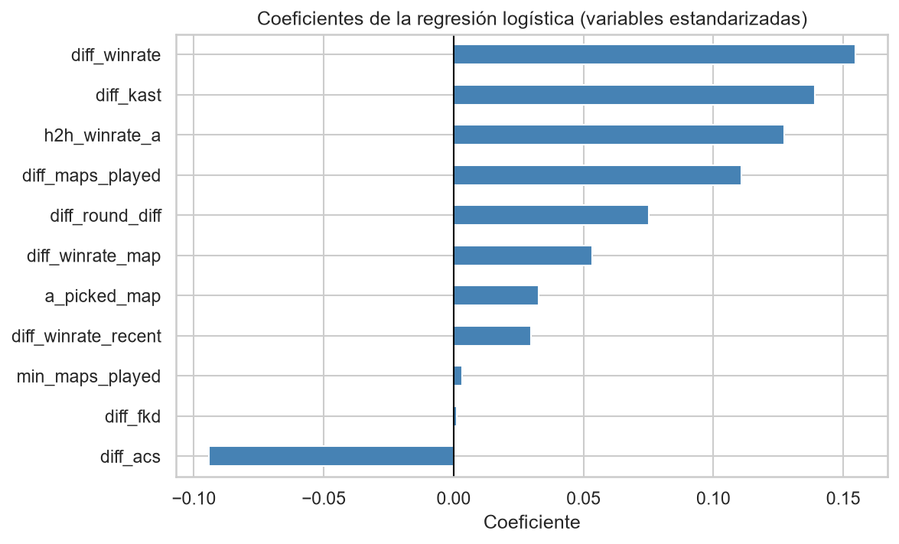

**Por qué este gráfico:** la ventaja de la regresión logística es que se puede "abrir": sus coeficientes dicen en qué dirección y con cuánta fuerza usa cada variable. Barras horizontales con una línea en 0 separan lo que empuja a favor y en contra.

**Cómo se lee:** cada barra es una variable. Una barra hacia la derecha (coeficiente positivo) significa que, cuando esa variable favorece a Team A, el modelo sube la probabilidad de que gane Team A; hacia la izquierda, que la baja. Cuanto más larga la barra, más pesa. Como las variables están estandarizadas, los largos se pueden comparar entre sí.

**Qué muestra:** los coeficientes son pequeños y están repartidos: winrate, KAST, enfrentamientos directos y experiencia empujan en el sentido esperado. `diff_acs` aparece con signo negativo, lo que **no** significa que tener mejor ACS perjudique: está muy correlacionada con `diff_round_diff` y `diff_kast` (cuadernillo 04) y, cuando varias variables cuentan lo mismo, la logística reparte el peso entre ellas de forma inestable. Por eso no conviene leer estos coeficientes uno por uno.

## Cuadernillo 06 — Modelo 2: Random Forest

Archivo: `models/06_modelo_random_forest.ipynb`

### 06.1

```python
import sys
sys.path.append("..")

import pandas as pd
import matplotlib.pyplot as plt
from sklearn.ensemble import RandomForestClassifier
from sklearn.impute import SimpleImputer
from sklearn.pipeline import make_pipeline

from src.config import PROCESSED_DIR, TABLES_DIR, load_config
from src.evaluation import accuracy_interval, evaluate, temporal_split
from src.plotting import set_style, save_fig

set_style()
config = load_config()
FEATURES, TARGET, SEED = config["features"], config["target"], config["seed"]

dataset = pd.read_csv(PROCESSED_DIR / "dataset.csv")
train, val, test = temporal_split(dataset, config["split"])
train_fit = train[train["min_maps_played"] >= config["min_train_history"]]
X_train, y_train = train_fit[FEATURES], train_fit[TARGET]
X_val, y_val = val[FEATURES], val[TARGET]
print(f"Entrenamiento: {len(train_fit)} mapas | Validación: {len(val)} mapas | Variables: {len(FEATURES)}")
```

**Qué hace:** importa lo necesario y prepara exactamente los mismos datos que usó la regresión logística.

- `RandomForestClassifier`: el modelo de este cuadernillo.
- `SEED = config["seed"]`: la semilla (42). El Random Forest usa azar al construirse; fijar la semilla hace que el resultado sea el mismo cada vez que se ejecuta.
- `temporal_split(...)`: partición por año (entrenamiento 2021–2024, validación 2025, prueba 2026).
- `train_fit = train[train["min_maps_played"] >= config["min_train_history"]]`: aplica el filtro decidido en el cuadernillo 05 (ambos equipos con 30 o más mapas previos), leyendo el umbral de la configuración.

**Por qué:** para que la comparación entre modelos sea justa, los tres se entrenan con los mismos mapas y las mismas variables, y se miden en la misma validación.

### 06.2

```python
model = make_pipeline(
    SimpleImputer(strategy="median", add_indicator=True),
    RandomForestClassifier(n_estimators=300, min_samples_leaf=20, random_state=SEED, n_jobs=-1),
).fit(X_train, y_train)

metrics = evaluate(y_val, model.predict_proba(X_val)[:, 1])
low, high = accuracy_interval(metrics["accuracy"], len(val))
print(f"Exactitud en validación: {metrics['accuracy']:.3f}  (IC 95 %: {low:.3f} – {high:.3f})")
pd.DataFrame({"Random Forest": metrics}).T.to_csv(TABLES_DIR / "06_resultados_random_forest.csv")

pd.DataFrame({"entrenamiento": evaluate(y_train, model.predict_proba(X_train)[:, 1]),
              "validación": metrics}).round(4)
```

**Qué hace:** construye el modelo, lo entrena, lo mide en validación (con su intervalo de confianza), guarda sus métricas y compara cómo le va en entrenamiento frente a validación.

- `make_pipeline(SimpleImputer(...), RandomForestClassifier(...))`: dos pasos encadenados; primero rellena los faltantes y luego entrena el bosque. Aquí no hace falta `StandardScaler`: a un árbol solo le importa el orden de los valores, no su escala.
- `n_jobs=-1`: usa todos los núcleos del computador para entrenar los árboles en paralelo.
- `.fit(X_train, y_train)`: entrena los 300 árboles.
- `model.predict_proba(X_val)[:, 1]`: para cada mapa, el promedio de lo que dicen los 300 árboles: P(gana Team A).
- La última tabla tiene dos columnas: las métricas calculadas sobre los mismos mapas con los que el modelo aprendió (`entrenamiento`) y sobre mapas nuevos (`validación`).

**Por qué:** la comparación entrenamiento-validación muestra el **sobreajuste**: el modelo siempre se ve mejor en los datos que ya conoce. Lo que cuenta es la columna de validación, porque así es como se usaría el modelo de verdad.

### 06.3

```python
importances = pd.Series(model[-1].feature_importances_, index=model[:-1].get_feature_names_out())
importances = importances[~importances.index.str.startswith("missingindicator")].sort_values()
ax = importances.plot.barh(color="seagreen", figsize=(8, 5))
ax.set(title="Importancia de las variables en el Random Forest", xlabel="Importancia")
save_fig("06_importancia_random_forest")
plt.show()
```

**Qué hace:** extrae la importancia que el bosque le asigna a cada variable y la dibuja en barras horizontales.

- `model[-1]`: el último paso del pipeline (el `RandomForestClassifier` entrenado). `.feature_importances_` es un arreglo con una importancia por columna de entrada; todas suman 1.
- `model[:-1].get_feature_names_out()`: nombres de las columnas que recibió el bosque (las 11 variables más los indicadores de faltante).
- La segunda línea quita los indicadores de faltante y ordena de menor a mayor.

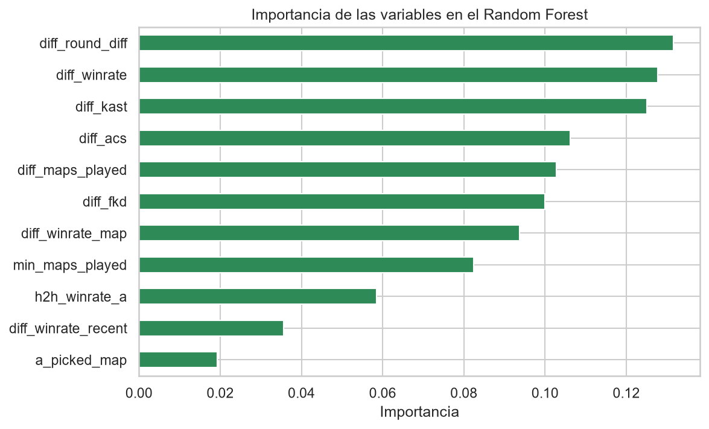

**Por qué este gráfico:** a un bosque de 300 árboles no se le pueden leer coeficientes como a la logística. La importancia de variables es la forma estándar de ver en qué se apoya, y las barras horizontales ordenadas dejan el ranking a la vista.

**Cómo se lee:** cada barra es una variable; su largo es la parte del "trabajo" de separar victorias de derrotas que hizo esa variable (las importancias de todas las columnas suman 1). Una barra más larga significa que el bosque la usó más y con más provecho. No indica dirección (a favor o en contra), solo cuánto se usa.

**Qué muestra:** el bosque reparte su atención entre varias variables de rendimiento (margen de rondas, winrate, KAST, ACS) y la experiencia; ninguna domina. `a_picked_map` casi no se usa: solo toma tres valores y su señal es mínima. Coincide con lo visto en el cuadernillo 04: la señal está repartida entre variables que cuentan historias parecidas.

## Cuadernillo 07 — Modelo 3: Gradient Boosting

Archivo: `models/07_modelo_gradient_boosting.ipynb`

### 07.1

```python
import sys
sys.path.append("..")

import pandas as pd
import matplotlib.pyplot as plt
from sklearn.ensemble import HistGradientBoostingClassifier
from sklearn.metrics import log_loss

from src.config import PROCESSED_DIR, TABLES_DIR, load_config
from src.evaluation import accuracy_interval, evaluate, temporal_split
from src.plotting import set_style, save_fig

set_style()
config = load_config()
FEATURES, TARGET, SEED = config["features"], config["target"], config["seed"]

dataset = pd.read_csv(PROCESSED_DIR / "dataset.csv")
train, val, test = temporal_split(dataset, config["split"])
train_fit = train[train["min_maps_played"] >= config["min_train_history"]]
X_train, y_train = train_fit[FEATURES], train_fit[TARGET]
X_val, y_val = val[FEATURES], val[TARGET]
print(f"Entrenamiento: {len(train_fit)} mapas | Validación: {len(val)} mapas | Variables: {len(FEATURES)}")
```

**Qué hace:** importa lo necesario y prepara los mismos datos que los cuadernillos 05 y 06 (partición por año y filtro de 30 mapas previos).

- `HistGradientBoostingClassifier`: la versión de Gradient Boosting de scikit-learn que se usa aquí.
- `log_loss`: la función de scikit-learn que calcula el log loss; se usa para dibujar la curva de la sección 2.

**Por qué:** mismos datos y mismas variables que los otros modelos, para que la comparación sea justa.

### 07.2

```python
default_model = HistGradientBoostingClassifier(random_state=SEED).fit(X_train, y_train)
pd.Series(evaluate(y_val, default_model.predict_proba(X_val)[:, 1])).round(4)
```

**Qué hace:** entrena un Gradient Boosting con todos los valores por defecto y muestra sus métricas en validación.

- `HistGradientBoostingClassifier(random_state=SEED)`: solo se fija la semilla; lo demás queda por defecto (100 árboles, `learning_rate=0.1`).
- Recibe `X_train` directamente, con sus valores faltantes: este modelo los acepta.

**Por qué:** sirve de punto de comparación. El log loss sale en 0.74, **peor que no saber nada** (0.693): el modelo por defecto está sobreajustado. La siguiente celda muestra por qué.

### 07.3

```python
model = HistGradientBoostingClassifier(max_depth=3, learning_rate=0.05, early_stopping=True,
                                       random_state=SEED).fit(X_train, y_train)
print("Árboles usados tras la parada temprana:", model.n_iter_)

def log_loss_por_arbol(modelo, X, y):
    """Log loss del modelo usando solo sus primeros 1, 2, 3… árboles."""
    return [log_loss(y, proba[:, 1]) for proba in modelo.staged_predict_proba(X)]

fig, ax = plt.subplots()
ax.plot(log_loss_por_arbol(default_model, X_train, y_train), label="Por defecto — entrenamiento", color="grey")
ax.plot(log_loss_por_arbol(default_model, X_val, y_val), label="Por defecto — validación", color="indianred")
ax.plot(log_loss_por_arbol(model, X_val, y_val), label="Conservador — validación", color="steelblue", linewidth=2.5)
ax.axhline(0.693, color="black", linestyle="--", linewidth=1, label="No saber nada (0.693)")
ax.set(title="Curva de log loss según el número de árboles", xlabel="Número de árboles",
       ylabel="Log loss (menor es mejor)")
ax.legend()
save_fig("07_curva_log_loss_arboles")
plt.show()
```

**Qué hace:** entrena el modelo conservador y dibuja la curva de log loss "árbol por árbol" de los dos modelos.

- `HistGradientBoostingClassifier(max_depth=3, learning_rate=0.05, early_stopping=True, ...)`: la configuración conservadora. `model.n_iter_` dice cuántos árboles terminó usando antes de detenerse.
- `log_loss_por_arbol(modelo, X, y)`: `staged_predict_proba(X)` va entregando las predicciones del modelo "por etapas": con 1 árbol, con 2, con 3… Para cada etapa se calcula el log loss (`proba[:, 1]` es P(gana Team A)). El resultado es una lista con un log loss por cada número de árboles.
- `ax.plot(lista, ...)`: dibuja una línea; el eje horizontal es la posición en la lista (el número de árboles).
- Se dibujan tres líneas: el modelo por defecto medido en entrenamiento y en validación, y el conservador en validación. `ax.axhline(0.693, ...)` es la referencia.

**Por qué:** una sola cifra (0.74) no explica el sobreajuste; la curva sí, porque muestra en qué momento el modelo deja de aprender y empieza a memorizar.


**Por qué este gráfico:** es una **curva de log loss** (una curva de aprendizaje): muestra cómo cambia el error del modelo a medida que se le agregan árboles. Es la forma más directa de *ver* el sobreajuste y de justificar por qué se usa una configuración conservadora.

**Cómo se lee:** el eje horizontal es el número de árboles que lleva el modelo; el vertical, su log loss (**más abajo es mejor**). La línea gris es el modelo por defecto medido en los mapas con los que entrena; la roja, el mismo modelo medido en validación; la azul, el modelo conservador en validación. La línea punteada es "no saber nada" (0.693).

**Qué muestra:**

- La línea gris baja sin parar: en entrenamiento, cada árbol nuevo "mejora" el modelo.
- La línea roja baja solo durante los primeros árboles y después **sube**, hasta quedar por encima de 0.693. El modelo dejó de aprender patrones generales y empezó a memorizar los mapas de entrenamiento. La separación creciente entre la gris y la roja *es* el sobreajuste.
- La línea azul baja despacio, se mantiene por debajo de 0.693 y se detiene sola: la parada temprana corta el entrenamiento antes de que empiece a memorizar.

### 07.4

```python
metrics = evaluate(y_val, model.predict_proba(X_val)[:, 1])
low, high = accuracy_interval(metrics["accuracy"], len(val))
print(f"Exactitud en validación: {metrics['accuracy']:.3f}  (IC 95 %: {low:.3f} – {high:.3f})")
pd.DataFrame({"Gradient Boosting": metrics}).T.to_csv(TABLES_DIR / "07_resultados_gradient_boosting.csv")
pd.Series(metrics).round(4)
```

**Qué hace:** mide el modelo conservador en validación, calcula el intervalo de confianza de su exactitud y guarda sus métricas para el cuadernillo de comparación.

- `evaluate(...)`: exactitud, ROC-AUC y log loss.
- `accuracy_interval(...)`: los extremos del intervalo de confianza del 95 %.
- `.to_csv(...)`: tabla de una fila con las métricas de este modelo.

**Por qué:** igual que en los cuadernillos 05 y 06, no se guarda el modelo como archivo, sino su resultado.

## Cuadernillo 08 — Comparación de modelos y evaluación final

Archivo: `notebooks/08_comparacion_y_evaluacion_final.ipynb`

### 08.1

```python
import sys
sys.path.append("..")

import numpy as np
import pandas as pd
import matplotlib.pyplot as plt
from sklearn.ensemble import HistGradientBoostingClassifier
from sklearn.impute import SimpleImputer
from sklearn.inspection import permutation_importance
from sklearn.linear_model import LogisticRegression
from sklearn.metrics import ConfusionMatrixDisplay, RocCurveDisplay
from sklearn.model_selection import RandomizedSearchCV, TimeSeriesSplit
from sklearn.pipeline import make_pipeline

from src.config import PROCESSED_DIR, TABLES_DIR, load_config
from src.evaluation import accuracy_interval, evaluate, temporal_split
from src.plotting import set_style, save_fig

set_style()
config = load_config()
FEATURES, TARGET, SEED = config["features"], config["target"], config["seed"]
MIN_HISTORY = config["min_train_history"]

dataset = pd.read_csv(PROCESSED_DIR / "dataset.csv")
train, val, test = temporal_split(dataset, config["split"])
y_val = val[TARGET]
```

**Qué hace:** importa lo necesario y vuelve a separar los datos por año.

- `permutation_importance`: mide cuánto aporta cada variable al modelo final (sección 6).
- `ConfusionMatrixDisplay`, `RocCurveDisplay`: dibujan la matriz de confusión y la curva ROC.
- `RandomizedSearchCV`, `TimeSeriesSplit`: búsqueda de la mejor configuración con validación cruzada temporal (sección 3).
- `MIN_HISTORY`: el umbral de 30 mapas previos guardado por el cuadernillo 05.

### 08.2

```python
results = {}
results["Base: clase mayoritaria"] = evaluate(y_val, np.full(len(val), train[TARGET].mean()))

rule_proba = np.select([val["diff_winrate"] > 0, val["diff_winrate"] < 0], [1.0, 0.0], default=0.5)
rule_decided = rule_proba != 0.5
results["Base: regla del winrate"] = {
    "accuracy": ((rule_proba > 0.5) == (y_val == 1))[rule_decided].mean(), "roc_auc": np.nan, "log_loss": np.nan}

one_variable = make_pipeline(SimpleImputer(strategy="median"), LogisticRegression())
one_variable.fit(train[["diff_winrate"]], train[TARGET])
results["Base: logística de 1 variable"] = evaluate(y_val, one_variable.predict_proba(val[["diff_winrate"]])[:, 1])

comparison = pd.concat([
    pd.DataFrame(results).T,
    pd.read_csv(TABLES_DIR / "05_resultados_regresion_logistica.csv", index_col=0),
    pd.read_csv(TABLES_DIR / "06_resultados_random_forest.csv", index_col=0),
    pd.read_csv(TABLES_DIR / "07_resultados_gradient_boosting.csv", index_col=0),
])
comparison.to_csv(TABLES_DIR / "08_comparacion_modelos.csv")
comparison.round(4)
```

**Qué hace:** calcula las tres líneas base en validación y las junta con los resultados de los tres modelos en una sola tabla.

- `results = {}`: diccionario vacío; cada entrada es el nombre de un método y sus métricas.
- **Clase mayoritaria:** `np.full(len(val), train[TARGET].mean())` crea un arreglo donde todos los mapas reciben la misma probabilidad (la proporción de victorias de A en entrenamiento, ≈ 0.50).
- **Regla del winrate:** `np.select([condición1, condición2], [1.0, 0.0], default=0.5)` asigna 1 si Team A tiene mejor winrate, 0 si lo tiene Team B y 0.5 si están empatados o falta el dato. `rule_decided` marca los mapas donde la regla sí elige a alguien; la exactitud se calcula solo sobre ellos. ROC-AUC y log loss quedan como `np.nan` (no aplican a un veredicto sin probabilidad).
- **Logística de una variable:** un pipeline pequeño (rellenar faltantes con la mediana + regresión logística) entrenado solo con `diff_winrate`. Los dobles corchetes `train[["diff_winrate"]]` devuelven una tabla de una columna, que es lo que scikit-learn espera.
- `pd.read_csv(..., index_col=0)`: lee la tabla de una fila que guardó cada cuadernillo de modelo, usando la primera columna (el nombre del modelo) como índice.
- `pd.concat([...])`: apila las líneas base y los tres modelos.

**Por qué:** la comparación solo es justa si todos se miden en los mismos mapas (validación 2025) y con las mismas métricas. Las líneas base responden la pregunta "¿el modelo aporta algo frente a lo más simple?".

### 08.3

```python
fig, axes = plt.subplots(1, 3, figsize=(16, 4.5))
colors = ["grey" if name.startswith("Base") else "steelblue" for name in comparison.index]
for ax, (metric, reference, limits) in zip(axes, [("accuracy", 0.5, (0.45, 0.62)),
                                                   ("roc_auc", 0.5, (0.45, 0.65)),
                                                   ("log_loss", 0.693, (0.66, 0.72))]):
    comparison[metric].plot.barh(ax=ax, color=colors)
    ax.axvline(reference, color="black", linestyle="--", linewidth=1)
    ax.set(title=metric, xlim=limits)
    ax.invert_yaxis()
plt.tight_layout()
save_fig("08_comparacion_modelos")
plt.show()

n = len(val)
for name in comparison.index[2:]:
    low, high = accuracy_interval(comparison.loc[name, "accuracy"], n)
    print(f"{name:<30} exactitud {comparison.loc[name, 'accuracy']:.3f}  (IC 95 %: {low:.3f} – {high:.3f})")
```

**Qué hace:** dibuja la tabla de comparación como tres gráficos de barras (uno por métrica) e imprime el intervalo de confianza de la exactitud de cada modelo.

- `plt.subplots(1, 3, figsize=(16, 4.5))`: una figura con tres gráficos en una fila; `axes` es la lista de los tres ejes.
- `colors`: lista por comprensión; gris para las filas cuyo nombre empieza por "Base" y azul para los modelos.
- `zip(axes, [...])`: empareja cada eje con una tupla `(métrica, valor de referencia, límites del eje)`. La referencia es 0.5 para exactitud y ROC-AUC y 0.693 para log loss.
- `comparison[metric].plot.barh(ax=ax, color=colors)`: barras horizontales de esa métrica en ese eje.
- `ax.invert_yaxis()`: deja el primer método arriba, en el mismo orden que la tabla.
- `plt.tight_layout()`: acomoda los tres gráficos para que no se monten.
- El `for` final recorre los métodos desde el tercero (`comparison.index[2:]`: la logística de una variable y los tres modelos) e imprime su exactitud con el intervalo de confianza. `{name:<30}` alinea el nombre a la izquierda en 30 caracteres.

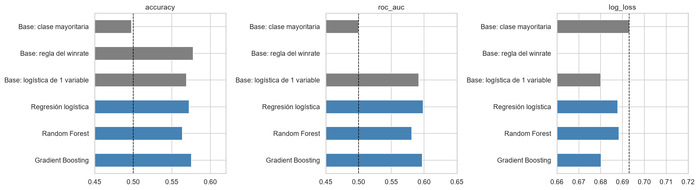

**Por qué este gráfico:** la tabla tiene 6 métodos y 3 métricas; en barras se ve de inmediato quién está por delante en cada métrica y, sobre todo, **qué tan cerca** están unos de otros.

**Cómo se lee:** hay un panel por métrica. Cada barra es un método: en gris las líneas base y en azul los modelos. La línea punteada es la referencia de "no saber nada" (0.5 en exactitud y ROC-AUC; 0.693 en log loss). En exactitud y ROC-AUC, **más a la derecha es mejor**; en log loss es al revés, **más a la izquierda es mejor**. Los ejes están recortados para que las diferencias se noten: son más pequeñas de lo que parecen. La regla del winrate no tiene barra en ROC-AUC ni en log loss porque no da probabilidades.

**Qué muestra:** todos superan al azar, pero los tres modelos quedan muy cerca entre sí y de las líneas base. El Gradient Boosting tiene el menor log loss de los tres modelos y la mayor exactitud; aun así empata en log loss con la logística de una sola variable.

### 08.4

```python
development = pd.concat([train, val])
development = (development[development["min_maps_played"] >= MIN_HISTORY]
               .sort_values(["stage_block", "match_id", "game_id"]))
X_dev, y_dev = development[FEATURES], development[TARGET]
print(f"Mapas para ajuste y entrenamiento final: {len(development)}")
development["year"].value_counts().sort_index().to_frame("maps").T
```

**Qué hace:** junta entrenamiento y validación en un solo conjunto de "desarrollo", le aplica el filtro de historial y lo ordena en el tiempo.

- `pd.concat([train, val])`: apila las dos tablas (2021–2025).
- `.sort_values(["stage_block", "match_id", "game_id"])`: orden cronológico (por etapa, luego partido, luego mapa).
- `X_dev, y_dev`: variables y objetivo del conjunto de desarrollo.

**Por qué:** una vez elegido el modelo, no tiene sentido desperdiciar 2025, que es el año más parecido a 2026. El conjunto de prueba (2026) sigue sin tocarse.

### 08.5

```python
cv = TimeSeriesSplit(n_splits=5)
search = RandomizedSearchCV(
    HistGradientBoostingClassifier(random_state=SEED),
    param_distributions={
        "learning_rate": [0.01, 0.02, 0.03, 0.05, 0.1],
        "max_iter": [50, 100, 200, 300],
        "max_depth": [2, 3, 4],
        "min_samples_leaf": [20, 50, 100, 200],
        "l2_regularization": [0, 0.1, 1, 10],
    },
    n_iter=40, cv=cv, scoring="neg_log_loss", random_state=SEED, n_jobs=-1,
)
search.fit(X_dev, y_dev)
print("Mejor combinación:", search.best_params_)
print(f"Log loss en validación cruzada: {-search.best_score_:.4f}")

cv_results = pd.DataFrame(search.cv_results_)
cv_results["log_loss"] = -cv_results["mean_test_score"]
cv_table = cv_results.sort_values("log_loss")[[c for c in cv_results.columns if c.startswith("param_")] + ["log_loss"]]
cv_table.to_csv(TABLES_DIR / "08_busqueda_hiperparametros.csv", index=False)
pd.concat([cv_table.head(3), cv_table.tail(3)]).round(4)
```

**Qué hace:** prueba 40 configuraciones distintas del Gradient Boosting, mide cada una con validación cruzada temporal y se queda con la mejor. Luego muestra las 3 mejores y las 3 peores.

- `TimeSeriesSplit(n_splits=5)`: define los 5 cortes temporales (entrenar con el pasado, validar con el bloque siguiente).
- `RandomizedSearchCV(modelo, param_distributions={...}, n_iter=40, ...)`: de todas las combinaciones posibles de los valores listados (5 × 4 × 3 × 4 × 4 = 960), elige 40 al azar.
- `cv=cv`: cada combinación se evalúa con los 5 cortes temporales (en total 40 × 5 = 200 entrenamientos).
- `scoring="neg_log_loss"`: la métrica a optimizar. scikit-learn siempre **maximiza**, así que usa el log loss con signo negativo; por eso después se le cambia el signo (`-search.best_score_`).
- `random_state=SEED`: fija cuáles 40 combinaciones salen, para que el resultado sea reproducible.
- `search.fit(X_dev, y_dev)`: ejecuta toda la búsqueda. Al terminar, vuelve a entrenar la mejor combinación con **todos** los datos de desarrollo.
- `search.best_params_`: la combinación ganadora. `search.cv_results_`: el detalle de las 40.
- Las últimas líneas convierten el detalle en tabla, calculan el log loss positivo, ordenan de mejor a peor, se quedan con las columnas de hiperparámetros (`param_...`) y guardan la tabla.

**Por qué:** elegir la configuración a mano es arbitrario; probar muchas y medirlas igual es más defendible. Se usa búsqueda aleatoria porque probar las 960 combinaciones sería lento y aporta poco. La validación es temporal por la misma razón que la partición: nunca se entrena con mapas posteriores a los que se usan para medir.

### 08.6

```python
final_model = search.best_estimator_
final_model
```

**Qué hace:** guarda en la variable `final_model` el modelo ganador de la búsqueda, ya entrenado con todos los datos de desarrollo, y lo muestra.

- `search.best_estimator_`: el modelo con la mejor combinación de hiperparámetros.

**Por qué:** el modelo final vive en esta variable mientras el cuadernillo está abierto. No se guarda en un archivo `.joblib`: para tenerlo de nuevo basta con ejecutar el cuadernillo, que con la misma semilla produce exactamente el mismo modelo.

### 08.7

```python
X_test, y_test = test[FEATURES], test[TARGET]
final_proba = final_model.predict_proba(X_test)[:, 1]

results = {}
results["Base: clase mayoritaria"] = evaluate(y_test, np.full(len(test), y_dev.mean()))

rule_proba = np.select([test["diff_winrate"] > 0, test["diff_winrate"] < 0], [1.0, 0.0], default=0.5)
rule_decided = rule_proba != 0.5
results["Base: regla del winrate"] = {
    "accuracy": ((rule_proba > 0.5) == (y_test == 1))[rule_decided].mean(), "roc_auc": np.nan, "log_loss": np.nan}

one_variable = make_pipeline(SimpleImputer(strategy="median"), LogisticRegression())
one_variable.fit(development[["diff_winrate"]], y_dev)
one_variable_proba = one_variable.predict_proba(test[["diff_winrate"]])[:, 1]
results["Base: logística de 1 variable"] = evaluate(y_test, one_variable_proba)

results["Modelo final: Gradient Boosting ajustado"] = evaluate(y_test, final_proba)

final_results = pd.DataFrame(results).T
final_results.to_csv(TABLES_DIR / "08_resultados_finales.csv")
final_results.round(4)
```

**Qué hace:** usa por primera vez los mapas de 2026: calcula las predicciones del modelo final y las métricas del modelo y de las tres líneas base.

- `X_test, y_test`: variables y objetivo del conjunto de prueba.
- `final_model.predict_proba(X_test)[:, 1]`: probabilidad de que gane Team A en cada mapa de 2026.
- Las tres líneas base se calculan igual que en la sección 1, pero ahora entrenadas con los datos de desarrollo y medidas en la prueba.
- `pd.DataFrame(results).T`: convierte el diccionario en tabla, con una fila por método.

**Por qué:** es la medida honesta del proyecto. Como 2026 no participó en ninguna decisión, este resultado no está inflado por haber elegido "lo que mejor funcionaba".

### 08.8

```python
rows = {}
for name, n in [("Base: regla del winrate", rule_decided.sum()),
                ("Base: logística de 1 variable", len(test)),
                ("Modelo final: Gradient Boosting ajustado", len(test))]:
    accuracy = final_results.loc[name, "accuracy"]
    low, high = accuracy_interval(accuracy, n)
    rows[name] = {"exactitud": accuracy, "IC 95 % inferior": low, "IC 95 % superior": high, "mapas": n}
pd.DataFrame(rows).T.round(3).astype({"mapas": int})
```

**Qué hace:** calcula el intervalo de confianza del 95 % de la exactitud para la regla del winrate, la logística de una variable y el modelo final.

- El `for` recorre pares `(nombre, n)`: el nombre del método y sobre cuántos mapas se midió su exactitud. La regla del winrate solo decide en algunos mapas (`rule_decided.sum()`); los otros dos usan los 886.
- `final_results.loc[name, "accuracy"]`: busca en la tabla de resultados la exactitud de ese método (`.loc[fila, columna]`).
- `accuracy_interval(accuracy, n)`: aplica la fórmula `exactitud ± 1.96 × raíz(exactitud × (1 − exactitud) / n)` y devuelve los dos extremos.
- `rows[name] = {...}`: guarda una fila por método; al final se convierte en tabla.

**Por qué:** un porcentaje medido sobre 886 mapas tiene margen de error. Sin el intervalo no se puede saber si "57.1 %" es de verdad mejor que "50 %" (azar) o que "56.0 %" (la regla simple), o si la diferencia podría deberse a la suerte de qué mapas tocaron.

### 08.9

```python
fig, axes = plt.subplots(1, 2, figsize=(13, 5))
ConfusionMatrixDisplay.from_predictions(y_test, final_proba > 0.5, ax=axes[0], cmap="Blues", colorbar=False,
                                        display_labels=["Gana Team B", "Gana Team A"])
axes[0].set(title="Matriz de confusión en prueba (2026)", xlabel="Predicción", ylabel="Resultado real")
axes[0].grid(False)
RocCurveDisplay.from_predictions(y_test, final_proba, name="Modelo final", ax=axes[1])
RocCurveDisplay.from_predictions(y_test, one_variable_proba, name="Logística de 1 variable", ax=axes[1])
axes[1].plot([0, 1], [0, 1], linestyle="--", color="black")
axes[1].set(title="Curva ROC en prueba (2026)", xlabel="Tasa de falsos positivos", ylabel="Tasa de verdaderos positivos")
save_fig("08_matriz_confusion_y_roc")
plt.show()
```

**Qué hace:** dibuja, lado a lado, la matriz de confusión del modelo final y su curva ROC (junto a la de la logística de una variable).

- `ConfusionMatrixDisplay.from_predictions(real, predicción, ...)`: cuenta los aciertos y errores de cada tipo. `final_proba > 0.5` convierte la probabilidad en un veredicto: se predice "gana Team A" si la probabilidad pasa de 50 %. `display_labels` pone nombres a las clases 0 y 1.
- `axes[0].grid(False)`: quita la cuadrícula de fondo, que estorba sobre la matriz.
- `RocCurveDisplay.from_predictions(real, probabilidad, name=..., ax=axes[1])`: dibuja la curva ROC y escribe su AUC en la leyenda. Se llama dos veces sobre el mismo eje para superponer las dos curvas.
- `axes[1].plot([0, 1], [0, 1], linestyle="--")`: la diagonal, que es la curva de un modelo que adivina al azar.

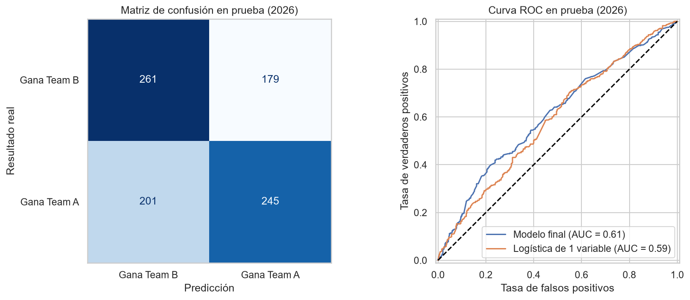

**Por qué este gráfico:** la exactitud resume todo en un número. La matriz de confusión muestra *qué tipo* de aciertos y errores hay detrás de él, y la curva ROC muestra el comportamiento del modelo sin depender del corte de 50 %. Son los dos gráficos estándar para evaluar un clasificador.

**Cómo se lee — matriz de confusión (izquierda):** las filas son lo que realmente pasó y las columnas lo que el modelo predijo. Las dos casillas de la diagonal (arriba-izquierda y abajo-derecha) son los **aciertos**; las otras dos, los **errores**. La exactitud es la suma de la diagonal dividida entre el total de mapas.

**Cómo se lee — curva ROC (derecha):** cada punto de la curva corresponde a un corte distinto de probabilidad para decir "gana Team A". El eje vertical es la proporción de victorias de A que el modelo detecta; el horizontal, la proporción de derrotas de A que marca por error como victorias. La diagonal punteada es adivinar al azar. Cuanto más se arquea la curva hacia la esquina superior izquierda, mejor; el **AUC** de la leyenda es el área bajo la curva (0.5 = azar, 1 = perfecto).

**Qué muestra:** los aciertos y los errores se reparten de forma similar entre las dos clases: el modelo no tiene preferencia por Team A ni por Team B, como debe ser después del intercambio aleatorio del cuadernillo 03. Las dos curvas ROC quedan por encima de la diagonal, pero no muy lejos: el modelo ordena mejor que el azar, con una ventaja modesta, y la del modelo final va ligeramente por encima de la línea base.

### 08.10

```python
importance = permutation_importance(final_model, X_test, y_test, scoring="neg_log_loss",
                                    n_repeats=50, random_state=SEED)
importance = pd.DataFrame({"mean": importance.importances_mean, "std": importance.importances_std},
                          index=FEATURES).sort_values("mean")
importance.to_csv(TABLES_DIR / "08_importancia_variables.csv")
ax = importance["mean"].plot.barh(xerr=importance["std"], color="seagreen", figsize=(8, 5))
ax.axvline(0, color="black", linewidth=1)
ax.set(title="Importancia por permutación en prueba (2026)", xlabel="Aumento del log loss al desordenar la variable")
save_fig("08_importancia_variables")
plt.show()
```

**Qué hace:** mide la importancia de cada variable para el modelo final desordenándola y viendo cuánto empeora la predicción; guarda la tabla y la dibuja.

- `permutation_importance(modelo, X, y, scoring="neg_log_loss", n_repeats=50, ...)`: para cada variable, mezcla sus valores entre los mapas 50 veces y cada vez mide el cambio en el log loss.
- `importances_mean` e `importances_std`: el promedio y la desviación estándar de esos 50 cambios. Se guardan en una tabla con una fila por variable.
- `.plot.barh(xerr=importance["std"], ...)`: barras horizontales con una "barra de error" (la rayita negra) del tamaño de la desviación estándar.

**Por qué:** saber en qué se apoya el modelo permite comprobar que usa las variables por razones con sentido, y contarlo.

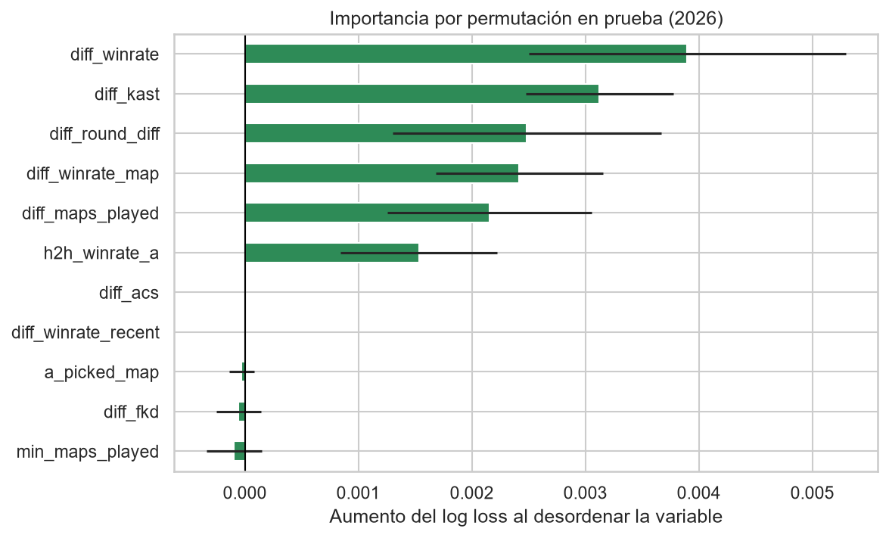

**Por qué este gráfico:** responde "¿en qué se fija el modelo?". La importancia por permutación sirve para cualquier modelo y se mide sobre datos que el modelo no vio, así que refleja lo que de verdad le sirve para predecir.

**Cómo se lee:** cada barra es una variable; su largo es cuánto **empeora** el log loss cuando esa variable se desordena. Barra larga = el modelo depende de ella. Barra en cero = el modelo no la usa. La rayita negra indica cuánto varía esa medida entre las 50 repeticiones: si la rayita cruza el cero, la importancia no es distinguible de nada.

**Qué muestra:** el modelo se apoya en seis variables: el winrate histórico (`diff_winrate`), la consistencia individual (`diff_kast`), el margen de rondas (`diff_round_diff`), el winrate en el mapa concreto (`diff_winrate_map`), la experiencia (`diff_maps_played`) y los enfrentamientos directos (`h2h_winrate_a`). Las otras cinco tienen importancia nula: con solo 50 árboles pequeños el modelo no llegó a usarlas. Todas las importancias son pequeñas (milésimas de log loss): ninguna variable es decisiva por sí sola.

### 08.11

```python
analysis = test.assign(proba=final_proba, correct=(final_proba > 0.5) == (y_test == 1))
analysis["confidence"] = (analysis["proba"] - 0.5).abs() + 0.5
print(f"Rango de probabilidades: {final_proba.min():.2f} – {final_proba.max():.2f}")
(analysis.groupby(pd.cut(analysis["confidence"], [0.5, 0.55, 0.6, 0.65, 1.0], include_lowest=True), observed=True)
 ["correct"].agg(accuracy="mean", maps="size").round(3))
```

**Qué hace:** agrupa los mapas de prueba según qué tan seguro estaba el modelo y calcula la exactitud en cada grupo.

- `test.assign(proba=..., correct=...)`: copia la tabla de prueba y le agrega dos columnas: la probabilidad predicha y si el modelo acertó (`True`/`False`).
- `confidence = |proba − 0.5| + 0.5`: la "confianza" es la probabilidad que el modelo le da a **su favorito**, sea A o B. Una probabilidad de 0.38 para A equivale a 0.62 para B, así que la confianza es 0.62.
- `pd.cut(..., [0.5, 0.55, 0.6, 0.65, 1.0], include_lowest=True)`: tramos de confianza; `include_lowest=True` incluye el valor 0.5 exacto en el primer tramo.
- `.agg(accuracy="mean", maps="size")`: exactitud y número de mapas por tramo.

**Por qué:** es la prueba práctica de que las probabilidades sirven. Si el modelo acertara lo mismo cuando dice 52 % que cuando dice 63 %, sus probabilidades no dirían nada.

# Parte 3. Las funciones de `src/`

Los cuadernillos importan funciones de la carpeta `src/`. Viven ahí por dos razones: se usan
en más de un cuadernillo (así no se copian ni se desincronizan) y algunas son largas y se
prueban de forma automática con los archivos de `tests/`. Los comentarios y descripciones
dentro de `src/` están en inglés, la convención habitual en código; aquí se explican en español.

## `src/config.py` — rutas y configuración

<!-- src: config.py -->
```python
ROOT = Path(__file__).resolve().parents[1]
CONFIG_PATH = ROOT / "config" / "config.yaml"
RAW_DIR = ROOT / "data" / "raw"
INTERIM_DIR = ROOT / "data" / "interim"
PROCESSED_DIR = ROOT / "data" / "processed"
FIGURES_DIR = ROOT / "reports" / "figures"
TABLES_DIR = ROOT / "reports" / "tables"


def load_config() -> dict:
    return yaml.safe_load(CONFIG_PATH.read_text(encoding="utf-8"))
```

**Qué hace:** define las carpetas del proyecto y una función para leer `config/config.yaml`.

- `Path(__file__)`: la ruta de este mismo archivo (`src/config.py`). `.resolve()` la vuelve absoluta y `.parents[1]` sube dos niveles: de `src/config.py` a la carpeta raíz del proyecto.
- `ROOT / "data" / "raw"`: con objetos `Path`, el operador `/` une carpetas. Funciona igual en Windows y en Linux.
- `load_config()`: lee el archivo YAML como texto y lo convierte en un diccionario de Python (`yaml.safe_load`). La flecha `-> dict` solo documenta qué devuelve.

**Por qué:** si las rutas se escribieran a mano en cada cuadernillo, mover el proyecto de carpeta los rompería todos. Así, cualquier cuadernillo encuentra los datos sin importar en qué computador se ejecute. `config.yaml` guarda la semilla, los años de cada conjunto, la lista de variables y el umbral de historial: los valores que comparten todos los cuadernillos.

## `src/plotting.py` — estilo y guardado de gráficos

<!-- src: plotting.py -->
```python
def set_style() -> None:
    sns.set_theme(style="whitegrid", palette="deep")
    plt.rcParams["figure.figsize"] = (9, 5)


def save_fig(name: str) -> Path:
    """Save the current figure to reports/figures/<name>.png and return its path."""
    path = FIGURES_DIR / f"{name}.png"
    plt.savefig(path, dpi=150, bbox_inches="tight")
    return path
```

**Qué hace:**

- `set_style()`: fija para todos los gráficos un fondo blanco con cuadrícula (`whitegrid`), una paleta de colores y un tamaño por defecto de 9 × 5 pulgadas.
- `save_fig(name)`: guarda el gráfico que se está dibujando en `reports/figures/<name>.png`. `dpi=150` da buena resolución; `bbox_inches="tight"` recorta los márgenes en blanco.

**Por qué:** que todos los gráficos se vean igual y queden guardados en una carpeta, listos para el informe, sin repetir esas líneas en cada celda.

## `src/data_loading.py` — carga y limpieza

### `load_table` y `load_ids`

<!-- src: data_loading.py -->
```python
def load_table(relative_path: str, years: list[int] | None = None) -> pd.DataFrame:
    """Read data/raw/vct_<year>/<relative_path> for every year and concatenate, adding `Year`."""
    years = years or load_config()["years"]
    frames = [
        pd.read_csv(RAW_DIR / f"vct_{year}" / relative_path, low_memory=False).assign(Year=year)
        for year in years
    ]
    return pd.concat(frames, ignore_index=True)
```

**Qué hace:** lee el mismo archivo (por ejemplo `matches/maps_scores.csv`) en la carpeta de cada año, le agrega una columna `Year` y pega todos los años en una sola tabla.

- `years: list[int] | None = None`: el parámetro `years` es opcional. Si no se pasa, vale `None`.
- `years = years or load_config()["years"]`: si `years` es `None`, usa los seis años de la configuración.
- `[... for year in years]`: lista por comprensión; por cada año lee un CSV. `low_memory=False` evita advertencias de pandas con archivos grandes de tipos mezclados. `.assign(Year=year)` agrega la columna del año.
- `pd.concat(frames, ignore_index=True)`: apila las seis tablas y renumera las filas de 0 en adelante.

`load_ids()` hace lo mismo con la tabla de identificadores, que viene en un solo archivo para todos los años.

### `clean_maps` — la tabla base

<!-- src: data_loading.py -->
```python
    key = MAP_KEY + ["Year"]
    scores = scores.drop_duplicates(key, keep=False)
    ids = ids.drop_duplicates(key, keep=False)[key + ["Match ID", "Game ID"]]
    df = scores.merge(ids, on=key, how="left")
    df = df.dropna(subset=["Match ID", "Game ID", "Team A Score", "Team B Score"])
    df = df[df["Team A Score"] != df["Team B Score"]]
    df = df[df[["Team A Score", "Team B Score"]].max(axis=1) >= 13]  # unfinished maps / forfeits
    df = df[df["Stage"] != "Showmatch"]
```

**Qué hace:** los mismos cinco filtros que el cuadernillo 01 hace paso a paso: quita claves duplicadas (en marcadores y en IDs), une los IDs, quita mapas sin ID o sin marcador, empates, mapas donde el ganador no llegó a 13 rondas y partidos de exhibición.

- `drop_duplicates(key, keep=False)`: elimina **todas** las copias de una clave repetida, no solo las sobrantes.
- `dropna(subset=[...])`: elimina las filas con algún vacío en esas columnas.

<!-- src: data_loading.py -->
```python
    out["team_a_win"] = (out["team_a_score"] > out["team_b_score"]).astype(int)
    out["stage_block"] = out.groupby(["year", "tournament", "stage"])["match_id"].transform("min")
    return out.sort_values(["stage_block", "match_id", "game_id"]).reset_index(drop=True)[MAPS_COLUMNS]
```

**Qué hace:** después de renombrar las columnas (bloque intermedio de la función), crea la variable objetivo y el bloque de etapa, y ordena.

- `team_a_win`: la comparación da `True`/`False`; `.astype(int)` lo convierte en 1/0.
- `stage_block`: `groupby([...])["match_id"].transform("min")` calcula el ID más bajo de cada etapa (año + torneo + etapa) y lo **repite en todas las filas** de esa etapa (a diferencia de `.min()`, que devolvería una sola fila por grupo). Es el "número de etapa" que se usa para que el historial solo mire etapas anteriores.
- `sort_values([...])`: orden cronológico aproximado: por etapa, luego partido, luego mapa.
- `reset_index(drop=True)`: renumera las filas después de ordenar. `[MAPS_COLUMNS]` deja las columnas en un orden fijo.

**Por qué:** la tabla base la usan todos los cuadernillos siguientes; tenerla en una función garantiza que siempre se construye igual. `tests/test_data_loading.py` comprueba con datos inventados que cada filtro funciona.

## `src/evaluation.py` — partición y métricas

<!-- src: evaluation.py -->
```python
def temporal_split(df: pd.DataFrame, split: dict) -> tuple[pd.DataFrame, pd.DataFrame, pd.DataFrame]:
    """Split by year according to config `split` = {train: [...], val: [...], test: [...]}."""
    return tuple(df[df["year"].isin(split[part])] for part in ("train", "val", "test"))
```

**Qué hace:** separa el dataset en entrenamiento, validación y prueba según los años de `config.yaml`.

- `df["year"].isin(lista)`: `True` si el año de la fila está en la lista.
- `tuple(... for part in ("train", "val", "test"))`: repite el filtro para las tres partes y devuelve las tres tablas juntas, en ese orden.

**Por qué:** es la separación por año explicada en la Parte 1. Al estar en una función, todos los cuadernillos parten los datos exactamente igual.

<!-- src: evaluation.py -->
```python
def evaluate(y_true, y_proba) -> dict:
    """Accuracy (threshold 0.5), ROC-AUC and log loss for predicted probabilities of class 1."""
    y_proba = np.asarray(y_proba, dtype=float)
    return {
        "accuracy": accuracy_score(y_true, y_proba > 0.5),
        "roc_auc": roc_auc_score(y_true, y_proba),
        "log_loss": log_loss(y_true, y_proba, labels=[0, 1]),
    }
```

**Qué hace:** recibe los resultados reales y las probabilidades predichas, y devuelve un diccionario con las tres métricas del proyecto.

- `np.asarray(y_proba, dtype=float)`: asegura que las probabilidades sean un arreglo de números (por si llegan como lista).
- `y_proba > 0.5`: convierte probabilidades en veredictos ("gana A" si pasa de 50 %) para calcular la exactitud.
- `roc_auc_score` y `log_loss` usan las probabilidades directamente. `labels=[0, 1]` le indica a `log_loss` cuáles son las dos clases aunque en una muestra pequeña apareciera solo una.

**Por qué:** las tres métricas se calculan decenas de veces; una sola función evita errores y garantiza que todos los modelos se miden igual.

<!-- src: evaluation.py -->
```python
def accuracy_interval(accuracy: float, n: int, z: float = 1.96) -> tuple[float, float]:
    """95 % confidence interval of an accuracy measured on `n` maps (normal approximation)."""
    half_width = z * np.sqrt(accuracy * (1 - accuracy) / n)
    return accuracy - half_width, accuracy + half_width
```

**Qué hace:** calcula el intervalo de confianza del 95 % de una exactitud medida sobre `n` mapas, con la fórmula explicada en la Parte 1.

- `half_width`: el margen de error, `1.96 × √(p(1 − p)/n)`. `np.sqrt` es la raíz cuadrada.
- Devuelve dos números: el extremo inferior y el superior.

**Por qué:** ver la sección "Por qué se usan intervalos de confianza" de la Parte 1.

## `src/features.py` — las variables históricas

Es el archivo más largo y el más importante del proyecto: convierte la tabla de mapas en el
dataset de modelado sin usar información del futuro. Tiene cuatro funciones.

### `to_number` — limpiar porcentajes

<!-- src: features.py -->
```python
def to_number(s: pd.Series) -> pd.Series:
    """'81%' -> 81.0, '' / None -> NaN."""
    return pd.to_numeric(s.astype("string").str.rstrip("%"), errors="coerce").astype(float)
```

**Qué hace:** convierte textos como `"81%"` en el número `81.0`. `str.rstrip("%")` quita el símbolo del final; `pd.to_numeric(..., errors="coerce")` convierte a número y deja `NaN` lo que no se puede convertir (textos vacíos).

### `team_map_stats` — qué hizo cada equipo en cada mapa

<!-- src: features.py -->
```python
    long = pd.concat([
        base.assign(side="a", team=maps["team_a"], opponent=maps["team_b"],
                    won=maps["team_a_win"], round_diff=score_diff),
        base.assign(side="b", team=maps["team_b"], opponent=maps["team_a"],
                    won=1 - maps["team_a_win"], round_diff=-score_diff),
    ]).drop(columns="team_a_win")
```

**Qué hace:** pasa la tabla de mapas (una fila por mapa, dos equipos) a formato "largo": **dos filas por mapa, una por equipo**, con su rival, si ganó (`won`) y su diferencia de rondas (`round_diff`, positiva si ganó). Para Team B, `won` es `1 − team_a_win` y la diferencia de rondas cambia de signo.

**Por qué:** el historial se acumula por equipo, y es mucho más fácil hacerlo cuando cada fila es "un equipo en un mapa".

<!-- src: features.py -->
```python
    players = overview[(overview["Side"] == "both") & (overview["Map"] != "All Maps")]
    players = players[RAW_KEY + ["Team"]].assign(
        **{name: to_number(players[col]) for name, col in PLAYER_STATS.items()})
    team_stats = (players.merge(game_ids, on=RAW_KEY)
                  .assign(team=lambda d: d["Team"].str.strip())
                  .groupby(["game_id", "team"])[list(PLAYER_STATS)].mean().reset_index())
```

**Qué hace:** saca de `overview` las estadísticas de los jugadores y las promedia por equipo y mapa.

- El filtro se queda con las filas `Side == "both"` (el mapa completo) y descarta el resumen `All Maps`: así cada jugador cuenta una sola vez (lo descubierto en el cuadernillo 00).
- `PLAYER_STATS` es un diccionario `{nombre corto: columna original}` (por ejemplo `"acs": "Average Combat Score"`). `**{...}` crea una columna por cada estadística, convertida a número con `to_number`.
- `.merge(game_ids, on=RAW_KEY)`: le pega el `game_id` a cada fila.
- `.assign(team=lambda d: d["Team"].str.strip())`: crea la columna `team` sin espacios sobrantes; `lambda d: ...` es una función de una línea que recibe la tabla.
- `.groupby(["game_id", "team"])[...].mean()`: promedio de los cinco jugadores de cada equipo en cada mapa.

El bloque siguiente de la función hace lo mismo con las rondas de pistola de `eco_stats`, y al final se unen ambas estadísticas a la tabla larga con `merge(..., how="left")` (los mapas sin estadísticas quedan con `NaN`, no se pierden).

### `_state_before_stage` — el corazón de la regla anti-fuga

<!-- src: features.py -->
```python
def _state_before_stage(long: pd.DataFrame, group: list[str], cols: list[str]) -> pd.DataFrame:
    """Value of running columns `cols` at the end of the previous stage block, per `group`."""
    state = long.groupby(group + ["stage_block"], sort=False)[cols].last().reset_index()
    state = state.sort_values("stage_block")
    state[cols] = state.groupby(group)[cols].shift(1)
    return state
```

**Qué hace:** recibe columnas **acumuladas** (por ejemplo, "mapas ganados hasta ahora") y devuelve, para cada equipo y cada etapa, el valor que tenían **al terminar la etapa anterior**.

- `groupby(group + ["stage_block"])[cols].last()`: para cada equipo y etapa, toma el último valor acumulado, es decir, cómo quedó el equipo al final de esa etapa.
- `sort_values("stage_block")`: ordena las etapas en el tiempo.
- `.groupby(group)[cols].shift(1)`: **desplaza los valores una etapa hacia abajo** dentro de cada equipo. Así, en la fila de la etapa 3 queda el valor con el que terminó la etapa 2. En la primera etapa de un equipo queda vacío (`NaN`): no tiene historial.

**Por qué:** es la traducción a código de la decisión del cuadernillo 01: como los IDs no ordenan los partidos dentro de una etapa, ningún mapa puede usar resultados de su propia etapa. El `shift(1)` garantiza que cada mapa solo vea lo acumulado hasta la etapa anterior.

### `build_dataset` — el dataset de modelado

<!-- src: features.py -->
```python
    by_team = long.groupby("team")
    running = pd.DataFrame({"team": long["team"], "stage_block": long["stage_block"]})
    running["n"] = by_team.cumcount() + 1
    for stat in MEAN_STATS:
        running[f"{stat}_sum"] = long[stat].fillna(0).groupby(long["team"]).cumsum()
        running[f"{stat}_n"] = long[stat].notna().groupby(long["team"]).cumsum()
    running["recent"] = by_team["won"].transform(lambda s: s.rolling(window, min_periods=1).mean())
```

**Qué hace:** recorre los mapas de cada equipo en orden y lleva **acumulados**: cuántos mapas lleva (`n`), y para cada estadística la suma de sus valores (`_sum`) y cuántos valores no vacíos ha tenido (`_n`).

- `by_team.cumcount() + 1`: numera los mapas de cada equipo: 1, 2, 3…
- `fillna(0)...cumsum()`: suma acumulada por equipo; los vacíos cuentan como 0 en la suma…
- `notna()...cumsum()`: …pero no cuentan en el número de valores. Así el promedio `suma / n` ignora los datos que faltaban.
- `rolling(window, min_periods=1).mean()`: promedio móvil de las victorias en los últimos `window` mapas (10): la forma reciente.

<!-- src: features.py -->
```python
    state_cols = [c for c in running.columns if c not in ("team", "stage_block")]
    team_state = _state_before_stage(running, ["team"], state_cols)

    prior = long[["game_id", "side", "team", "opponent", "map", "stage_block"]].merge(
        team_state, on=["team", "stage_block"], how="left")
    feats = prior[["game_id", "side"]].copy()
    feats["maps_played"] = prior["n"].fillna(0)
    for stat in MEAN_STATS:
        feats[stat] = prior[f"{stat}_sum"] / prior[f"{stat}_n"].where(prior[f"{stat}_n"] > 0)
    feats["recent"] = prior["recent"]
```

**Qué hace:** aplica la regla anti-fuga y calcula los promedios históricos.

- `_state_before_stage(...)`: toma los acumulados **al final de la etapa anterior**.
- `.merge(team_state, on=["team", "stage_block"])`: le pega a cada fila equipo-mapa esos acumulados.
- `maps_played`: mapas previos; si no hay historial, 0.
- `suma / n.where(n > 0)`: promedio histórico de cada estadística (winrate, diferencia de rondas, ACS, KAST…). `.where(n > 0)` deja `NaN` en lugar de dividir entre cero.

<!-- src: features.py -->
```python
    for name, group in [("map", ["team", "map"]), ("h2h", ["team", "opponent"])]:
        run = long[group + ["stage_block"]].copy()
        run["n"] = long.groupby(group).cumcount() + 1
        run["wins"] = long.groupby(group)["won"].cumsum()
        state = _state_before_stage(run, group, ["n", "wins"])
        merged = long[group + ["stage_block"]].merge(state, on=group + ["stage_block"], how="left")
        feats[f"{name}_n"] = merged["n"].fillna(0).to_numpy()
        feats[f"{name}_winrate"] = (merged["wins"] / merged["n"]).to_numpy()
```

**Qué hace:** repite la misma idea dos veces, pero agrupando de otra forma: por equipo **y mapa** (cómo le va a un equipo en ese escenario concreto) y por equipo **y rival** (enfrentamientos directos, *head to head*). Para cada caso calcula mapas jugados y winrate antes de la etapa.

**Por qué un `for`:** las dos variables se calculan igual; solo cambia la agrupación. El bucle evita escribir el mismo bloque dos veces.

<!-- src: features.py -->
```python
    def diff(col):
        return (a[col] - b[col]).reindex(ids).to_numpy()

    out["diff_winrate"] = diff("won")
```

**Qué hace:** `a` y `b` son las filas de Team A y de Team B de cada mapa. `diff(col)` calcula, para cada mapa, el valor de Team A menos el de Team B en esa columna. `.reindex(ids)` pone los resultados en el mismo orden que la tabla de mapas. Las líneas siguientes de la función crean así todas las variables `diff_...`, además de `h2h_winrate_a`, `a_picked_map` (con la función auxiliar `_picked_map`, que busca en `draft_phase` qué equipo eligió el mapa) y `min_maps_played`.

**Por qué diferencias:** lo que importa no es qué tan bueno es un equipo en general, sino qué tan bueno es **comparado con su rival**.

<!-- src: features.py -->
```python
    swap = np.random.default_rng(seed).random(len(out)) < 0.5
    out.loc[swap, ["team_a", "team_b"]] = out.loc[swap, ["team_b", "team_a"]].to_numpy()
    out.loc[swap, DIFF_FEATURES + ["a_picked_map"]] *= -1
    out["a_picked_map"] += 0.0  # turn -0.0 into 0.0
    out.loc[swap, "h2h_winrate_a"] = 1 - out.loc[swap, "h2h_winrate_a"]
    out.loc[swap, "team_a_win"] = 1 - out.loc[swap, "team_a_win"]
```

**Qué hace:** el intercambio aleatorio de Team A y Team B (cuadernillo 02).

- `np.random.default_rng(seed).random(len(out)) < 0.5`: un número al azar entre 0 y 1 por fila; las filas con número menor que 0.5 (la mitad, en promedio) se intercambian. Con la misma semilla, siempre son las mismas filas.
- En esas filas se intercambian los nombres, se cambia el signo de todas las diferencias (`*= -1`), el winrate directo pasa a ser el del otro equipo (`1 − valor`) y el objetivo se invierte (`1 − team_a_win`).
- `+= 0.0`: detalle técnico; multiplicar 0 por −1 da "−0.0", y sumar 0.0 lo deja como 0.0.

**Por qué:** la web lista primero al favorito, así que sin el intercambio el modelo aprendería "Team A suele ganar". Después del intercambio el objetivo queda en 50 % y el modelo solo puede apoyarse en el rendimiento.

## `tests/` — comprobaciones automáticas

Los archivos de `tests/` no forman parte del análisis: son comprobaciones que se ejecutan con
`python tests/test_data_loading.py` y `python tests/test_features.py`. Construyen un torneo
inventado de tres etapas y tres equipos, con resultados conocidos, y verifican que:

- `clean_maps` elimina duplicados, empates, mapas sin ID y mapas incompletos;
- cambiar todos los resultados de una etapa **no cambia** ninguna variable de esa misma etapa
  (prueba directa de que no hay fuga);
- borrar mapas futuros no cambia las variables de mapas anteriores;
- en la primera etapa de un equipo sus variables quedan vacías;
- los valores calculados coinciden con los calculados a mano;
- intercambiar Team A y Team B invierte el signo de las diferencias y el objetivo.

Si alguna de estas propiedades se rompiera al modificar `src/features.py`, la prueba lo
mostraría de inmediato con un mensaje de error.
